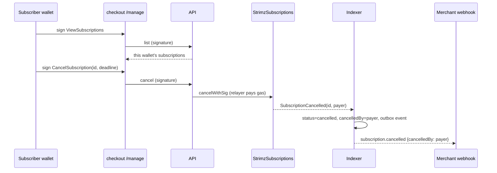

# ADR: Subscribers cancel from a hosted page, and every cancel reaches the merchant

- **Status:** Accepted 2026-11-20 by the founder
- **Date:** 2026-11-20
- **Issues:** #499 (Manage subscription page), #500 (webhook for wallet cancels)
- **Depends on:** ADR-2026-11-19-mainnet-audit-fixes §6 (`cancelWithSig`)
- **Scope:**
  - Checkout: a new page.
  - API: two public routes and one relay reason.
  - Prisma: the `Subscription.cancelledBy` column.
  - Indexer: the cancel projection and its webhook.
  - `@strimz/shared-types` and `@strimz/sdk`: a new optional field, so a changeset.
  - Email templates (link only), docs, and the full-stack e2e.

## Context

- **No cancel page.** A subscriber can cancel only through a cancel button the merchant built, or with a raw `cancel(subscriptionId)` from their wallet. Strimz has no page for it, and the docs say so.
- **A wallet cancel is silent.** The indexer marks the row cancelled (`MarkSubscriptionCancelled`) but sends no webhook. A merchant that grants access from webhooks never learns the subscriber left.
- **The webhook doesn't say who cancelled,** so a merchant can't tell "the customer left" from "we cancelled them".

## Decision

1. **Page: `checkout.strimz.finance/manage`.**
   - The subscriber connects a wallet.
   - They sign an EIP-712 `ViewSubscriptions(address payer,uint256 issuedAt)`, valid for 10 minutes. That proves ownership without gas.
   - The page lists that wallet's `trialing`, `active` and `at_risk` subscriptions in this deployment's mode: merchant name, plan, amount, next charge, status.
   - **Cancel** asks for one signature, EIP-712 `CancelSubscription(subscriptionId, deadline)` on the Subscriptions domain, valid for 30 minutes.
   - The page then shows "Cancelling…" until the on-chain cancel is indexed, then "Cancelled. You won't be charged again."
   - It reuses the checkout shell. Light and dark themes are supported. Loading, empty and error states are spelled out.
   - The link `/manage?subscription=<id>` pre-selects one subscription.
2. **API (public, rate-limited):**
   - `POST /v1/checkout/manage/subscriptions`
     - Takes `{ payer, issuedAt, signature }`.
     - Verifies the signature: `ecrecover` for an EOA, ERC-1271 through the RPC for a contract wallet.
     - Returns the list. Never another wallet's subscriptions.
   - `POST /v1/checkout/manage/subscriptions/:id/cancel`
     - Takes `{ deadline, signature }`.
     - Checks that the subscription exists, belongs to the signer, and isn't already cancelled or lapsed.
     - Checks the signature off-chain first, then relays `cancelWithSig` with the new relay reason `cancelWithSig`.
     - Idempotent on the call data. Returns the relay submission, which the page polls.
   - The API doesn't flip the row itself. The indexer does that on the confirmed event, so there is one source of truth and one webhook.
3. **Who cancelled:**
   - New nullable column `Subscription.cancelledBy`, enum `payer | merchant | strimz`, with a migration.
   - The merchant API and dashboard cancel set `merchant`.
   - The admin cancel sets `strimz`.
   - When the indexer's cancel projection is the first to cancel the row, it sets `cancelledBy` from the event's `by` address:
     - the subscription's payer: `payer`;
     - the merchant's on-chain owner: `merchant`;
     - anything else (the canceller role): `strimz`.
4. **Webhook (#500):**
   - When the indexer's projection flips a row to `cancelled`, it writes a `subscription.cancelled` outbox event in the same transaction.
   - If the API already cancelled the row, the projection changes nothing and sends nothing. Each cancel produces exactly one event.
   - `subscriptionSchema` gains `cancelledBy: 'payer' | 'merchant' | 'strimz' | null`. Adding an optional field is non-breaking for merchants who parse leniently. `@strimz/shared-types` and `@strimz/sdk` get a minor changeset, and the docs list the field.
5. **Emails:** every payer email (receipt, renewal, failed charge, allowance reminder) gets a "Manage or cancel" link to `/manage?subscription=<id>`.
6. **Tests:**
   - Red first: a Go store test where a wallet cancel emits one `subscription_cancelled` with `cancelledBy = payer`, and an API cancel followed by the on-chain event emits nothing more.
   - API tests:
     - the list refuses a bad or expired signature, and never returns another wallet's rows;
     - cancel refuses a stranger's signature.
   - Full-stack e2e:
     - the subscriber cancels through the new routes;
     - `cancelWithSig` lands, the row becomes `cancelled` with `cancelledBy = payer`, and the merchant receives `subscription.cancelled`;
     - after a 30-day warp, no charge is made and no money moves.
   - A checkout component test for the page states.
   - Docs: rewrite `subscriptions/cancellation.mdx`, including removing its stale "on-chain cancel still reverts" line.

## Trade-offs

- **Gasless, with a contract change,** rather than the subscriber paying about $0.005 in gas. Smart and embedded wallets often hold no gas, and we're redeploying anyway.
- **A signature to view the list,** rather than a public lookup by address. The list is derivable on-chain, but Strimz shouldn't hand out a wallet's merchants to anyone who types an address.
- **The cancel is immediate, as today.** "Cancel at period end" is a separate product decision. The page says "You won't be charged again". It doesn't promise access until the period ends, because access is the merchant's call.

## Diagram

## Implementation notes (2026-11-21)

These came up while building and don't change the decision.

- **At most 3 relayed cancels per subscription per day.** A smart-wallet payer can pass the gas estimate and then revert on chain, and Strimz pays for every attempt. After the third attempt the API answers `429 cancel_attempts_exhausted`, and the subscriber can still cancel from their wallet. Replays of the same signed cancel don't count.
- **Cancels skip the merchant's relay budget.** `RelayBudgetService.consume` refuses once a merchant's daily quota is spent, which would stop subscribers from leaving. A subscription can only be cancelled once on chain, which bounds the cost, and the routes are IP rate-limited.
- **No API admin cancel exists,** so only the merchant API sets `cancelledBy = merchant`. `strimz` comes from the indexer, for an on-chain cancel by any address that is neither the payer nor the merchant's `walletAddress`.
- **Emails:** there is no payer failed-charge email. The link went into the three payer subscription emails: started, charged and the allowance reminder.
- **`ViewSubscriptions` domain:** `{ name: 'Strimz', version: '1', chainId }`, with no verifying contract. The type lives in `@strimz/sdk/eip712`, so checkout and the API share one definition.
- **Page states:** checkout has no DOM test library. The states are a pure reducer (`lib/manage-subscriptions.ts`) with unit tests, and the rendered page was checked by hand in light and dark themes.
