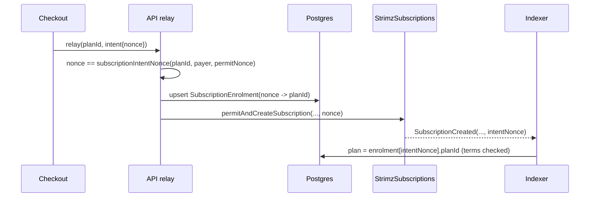

# ADR: Record which plan a subscription signup was for

- **Status:** Accepted 2026-11-20 by the founder
- **Date:** 2026-11-20
- **Issue:** #497
- **Depends on:** ADR-2026-11-19-mainnet-audit-fixes §5 (`SubscriptionCreated` carries `intentNonce`)
- **Scope:**
  - Prisma: one new table and its migration.
  - API: the relay writes the record.
  - Indexer: the `SubscriptionCreated` projection, and the plan-matching fallback.
  - The full-stack e2e and the Go store e2e.
  - No webhook or public API shape changes.

## Context

`SubscriptionCreated` doesn't say which plan the payer chose. The indexer guesses with `findOrCreatePlan`, which takes the first active plan with the same merchant, amount, currency and interval (`LIMIT 1`, no order).

If a merchant has two such plans (two products at 10 USDC a month, for example), a subscriber to plan B can be filed under plan A. The wrong `planId` then follows the subscription everywhere:

- the `subscription.*` webhooks, so the merchant may grant the wrong product;
- the dashboard's per-plan counts;
- the "already subscribed?" check;
- the relay's double-enrolment guard (`alreadyEnrolledView`), which looks up by plan and can miss.

The full-stack e2e shows it: two suites with 2 USDC monthly plans, and the second signup lands on the first plan.

The plan is already bound cryptographically. The relay refuses any intent whose nonce isn't `subscriptionIntentNonce(planId, payer, permitNonce)` (`relay.service.ts` `assertIntentNonce`). But the link between nonce and plan only lives in a BullMQ job, which ages out after an hour.

## Decision

1. **New table, `SubscriptionEnrolment`:**
   - `intentNonce` (bytes32 hex, lowercase, primary key), `merchantId`, `planId`, `payerAddress`, `createdAt`. No `mode`: the public checkout route has none, and each indexer runs in one mode;
   - indexed on `(merchantId, payerAddress)`;
   - Prisma migration `add_subscription_enrolment`.
2. **The API writes it** in `submitPermitAndCreateSubscription`, after `assertIntentNonce` passes and before the job is enqueued.
   - It's an upsert on `intentNonce`, so a retry is a no-op.
   - The nonce came from `assertIntentNonce` itself, so a forged plan id can't be recorded against someone else's nonce.
3. **The indexer resolves the plan** in this order:
   1. If the event's `intentNonce` is non-zero and a `SubscriptionEnrolment` row has that nonce for the event's merchant, use its `planId`. The indexer also checks that the plan's amount, currency and interval match the event. If they don't, it logs an error and falls through, rather than filing the subscription under a plan with other terms.
   2. Otherwise, look for active plans with the same terms. If there's exactly one, use it.
   3. If there are several (only possible for a direct `createSubscription` outside Strimz checkout), use the oldest by `createdAt`. That makes the choice deterministic, and the subscription's metadata gets `planMatch: "ambiguous"` so the dashboard can flag it.
   4. If there are none, auto-create a plan as today.
4. **The relay's double-enrolment guard** keeps its plan lookup. It's now correct, because rows carry the right plan.
5. **Tests:**
   - Red first: a Go store e2e with two same-terms plans and an enrolment row for the second. The subscription must land on the second.
   - Ambiguous and single-match fallbacks.
   - An API unit test that the enrolment row is written with the plan from the route.
   - The full-stack renewal test goes back to 2 USDC: the collision workaround in #498 is removed, and both suites pass.

## Trade-offs

- **A table, rather than reading calldata from the indexer.** Calldata decoding only works when our relayer sends the transaction directly, and it costs one RPC call per signup on an RPC with tight limits. The event field works for any caller.
- **Oldest plan on ambiguity, rather than an "unmatched" plan.** Ambiguity can only come from a signup outside Strimz checkout. A deterministic choice plus a visible flag is less surprising than a plan the merchant never made.

## Diagram

