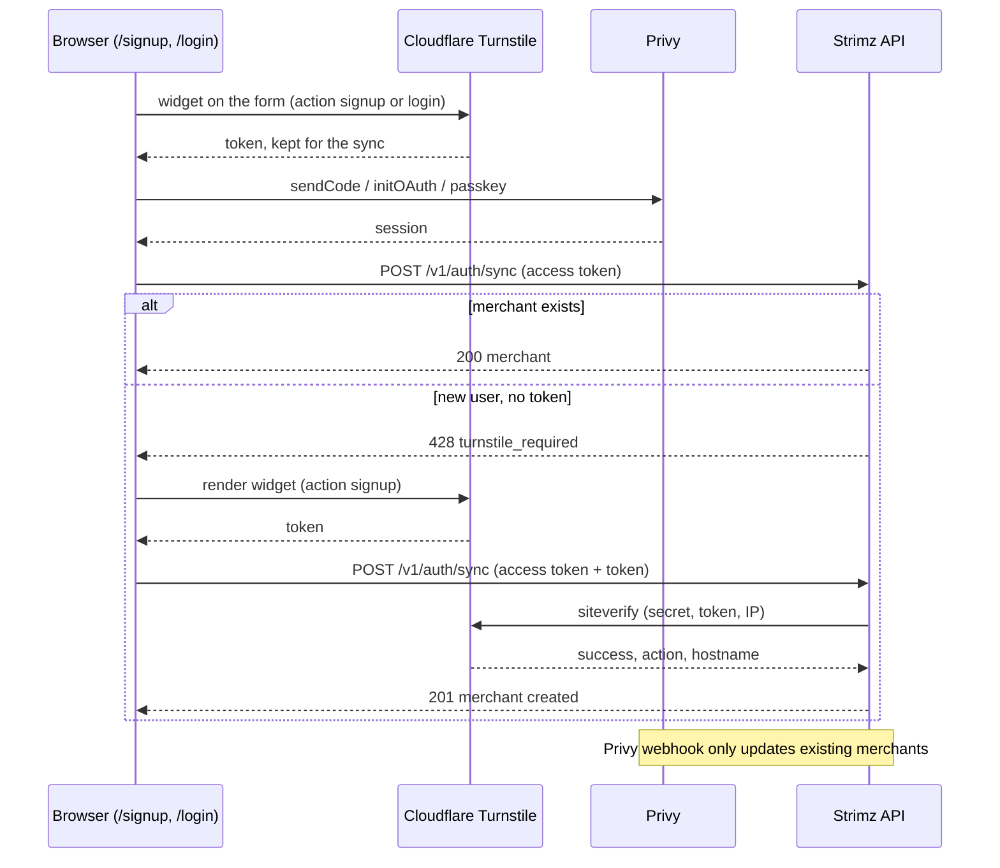

# ADR-2026-11-21: Custom sign-up and login screens, passkeys and server-checked bot protection

- **Status:** Accepted 2026-11-21 by the founder. The admin console keeps the Privy modal.
- **Deciders:** the founder
- **Related:**
  - Turnstile findings from 2026-11-21: a real tester failed Privy's invisible CAPTCHA;
  - the reference pattern at `wsws/frontend@418d41a8`, `components/auth/*`;
  - #508 (terms consent), which comes later and uses the same screens.

## Context

The merchant dashboard signs people in through Privy's modal (`@privy-io/react-auth` 1.97, `PrivyContinueButton`). The modal offers email, wallet and Google.

- **Problems with the modal:**
  - We can't style it to the design system.
  - We can't remove "Continue with a wallet" without changing the shared Privy app.
  - When Privy's invisible CAPTCHA fails, the tester sees a dead end we can't explain.
- **How a merchant account comes to exist today:** `AuthService.syncByPrivyUserId` creates the `Merchant` row. It's reached from two places:
  1. `POST /v1/auth/sync`, which the `/callback` page calls after Privy login;
  2. the Privy webhook (`user.authenticated` and four other events), with no user present.
- **Strimz already refuses accounts with no email** (`permission_denied`, "an email-based login is required"). A wallet-only Privy user therefore never became a merchant. Every existing merchant can sign in with an email code, or with Google if that's how they signed up.
- **Our Turnstile** (`TurnstileService`, `NEXT_PUBLIC_TURNSTILE_SITE_KEY`) is used only by the contact form today.

### What a bot can do today, and what a browser-only check can't stop

- **Privy's API is public** for our app id. A script can ask Privy for email codes, or start Google sign-in, without loading our page. So a Turnstile widget that only runs in our page doesn't stop it.
  - The only checks that hold are ones a server enforces: Privy's own CAPTCHA (enforced by Privy) and a Turnstile token our API verifies.
- **The webhook path creates merchants with no user present.** If we gate only `/auth/sync`, a bot that completes Privy login still gets a `Merchant` row through `user.authenticated`. Today that's harmless only because nothing checks for bots at all.

## Decision

### 1. Our own screens, on Privy's headless hooks (Privy 3.x)

- **Upgrade** `@privy-io/react-auth` from 1.97 to the current 3.x (the reference uses 3.35.1) in `packages/web-shared`, `apps/dashboard` and `apps/admin`.
  - Config changes: `embeddedWallets.createOnLogin` becomes `embeddedWallets.ethereum.createOnLogin: 'users-without-wallets'`.
  - Other breaking changes are handled as the build finds them, each covered by the existing auth tests.
- **`/signup`:** "Continue with Google" (`useLoginWithOAuth`, `google`) and email with a 6-digit code (`useLoginWithEmail`: `sendCode`, then `loginWithCode`).
- **`/login`:** the same two, plus "Sign in with a passkey" (`useLoginWithPasskey`). The passkey button shows only where the browser supports WebAuthn.
- **Reference pattern** (`tsion-corp/tsionmarket-frontend`, `components/auth/*`, used at `418d41a8`): one form per method, a 6-digit code input, and a passkey offer after sign-in. Its auth never used Turnstile, so that part is new here.
- **No wallet login.** It's removed from `loginMethods` and turned off in the Privy dashboard. Merchants still connect wallets inside the dashboard for on-chain owner actions; that isn't sign-in.
- **The screens follow `docs/design/strimz-design-system.md`** in light and dark, label inputs `(required) *`, and handle every state:
  - sending;
  - wrong code;
  - expired code;
  - resend, with a 30-second cooldown;
  - Google cancelled;
  - passkey cancelled;
  - unsupported browser.
- **Privy's errors are mapped to plain sentences.** Raw errors go to the console only.

### 2. Passkeys

- **Onboarding** gets an optional step, "Add a passkey" (`useLinkWithPasskey`), after the business details. "Skip for now" always works, and a failure never blocks onboarding.
- **Returning merchants without a passkey** are offered the same step after login, as in the reference. It's skippable, at most once a week per device, and never shown to an account that already has a passkey.
- **Settings → Security** lists the account's passkeys and lets the merchant add or remove one.
  - Removal is refused when it would leave the account with no way in. Privy refuses that too; we check first, so the message is clear.
  - Each add and removal writes an audit log entry, from the Privy webhook's `user.linked_account` and `user.unlinked_account` events, which already reach the API.
- **A passkey can only be added to a signed-in account.** So a passkey login always reaches an existing merchant and never creates one.

### 3. Bot protection: Cloudflare Turnstile, checked by our server

Privy's invisible CAPTCHA (Turnstile) is on in the Privy dashboard (founder, 2026-11-21) and rendered beside our forms with `<Captcha />`. On top of it, our own Turnstile works in two places.

- **On the forms, as a first barrier.**
  - `/signup` and `/login` render one Turnstile widget in managed mode, usually invisible: action `signup` or `login`.
  - "Send code", "Continue with Google" and "Sign in with a passkey" stay disabled until it passes.
  - The token is kept in `sessionStorage` for the account-creation check below, so it survives Google's redirect.
  - On failure the form says "We couldn't confirm you're not a bot. Try again, or try another browser", with a retry and the error code in the console.
- **At account creation, as the real wall.**
  - `POST /v1/auth/sync` takes an optional `turnstileToken`.
  - When no `Merchant` exists for the Privy user, the API verifies the token server-side with `TURNSTILE_SECRET_KEY`. It checks `success`, the action `signup`, and a hostname on the dashboard allow-list. Only then does it create the row.
  - Without a valid token it answers `428 turnstile_required` and creates nothing. `/callback` then renders the widget and retries; this covers an expired token (tokens last 300 seconds and are single-use).
  - Existing merchants don't need a token.
- **The Privy webhook never creates merchants.** It refreshes existing rows only; for a user with no `Merchant` it logs and stops. So a verified `/auth/sync` is the only way a Strimz account is created.
- **The per-IP rate limit on `/auth/sync` stays** (30 a minute).
- **What each layer covers.**
  - Privy's CAPTCHA stops scripts that call Privy directly from requesting code emails or creating Privy users.
  - Our Turnstile, checked by the API, stops anything without a passed check from creating a Strimz account.
  - If Privy's CAPTCHA ever fails real people, switching it off is one toggle. Account creation stays protected by our check.

### 4. Admin console

- **The admin console moves to Privy 3.x with the shared package, but keeps Privy's modal for now.** Admins are invited one by one, so bots aren't a concern there.
- **Its login methods drop wallet, to match the Privy app settings.** If an admin signs in only with a wallet, they need to link an email first; super admins can check this in Privy's dashboard before the switch.
- **A custom admin sign-in can follow later** if you want one.

### 5. Existing accounts

No merchant is wallet-only, because sync has always required an email. Merchants who signed up with Google keep using Google; everyone else uses an email code. So no account loses access.

## Diagram

## Consequences

- **Good:**
  - The screens match the design system.
  - There's no wallet login.
  - Merchants can use passkeys.
  - A bot that completes Privy login still can't create a Strimz account without passing our server-checked Turnstile.
  - CAPTCHA failures now explain themselves.
- **Cost:**
  - A major Privy upgrade across three apps.
  - New screens and states to test.
  - A new `428` for first-time sync.
  - A short Turnstile step for new merchants (usually invisible).
- **Risk:**
  - Privy 3.x behaviour changes we haven't seen yet. Mitigation: the auth tests, a full manual run of every state on a preview build, and a check of `admin-sign-in` and `auth-login-flow`.
  - Turnstile outage. A new merchant can't finish signup until it recovers; existing merchants are unaffected.
- **Not in scope:**
  - #508 terms consent. It comes next and adds the checkbox to these screens.
  - A custom admin sign-in.

## Test plan

- **API e2e:**
  - sync for a new user with no token, or a bad token, answers `428` and creates nothing;
  - with a valid token it creates the merchant;
  - an existing merchant needs no token;
  - a token minted for another action or host is refused;
  - the webhook creates nothing for an unknown user and still updates a known one.
- **Dashboard unit tests:**
  - error mapping for each Privy and CAPTCHA failure;
  - the code-step state machine;
  - passkey button visibility;
  - the callback page's `428` retry.
- **Manual, on a preview build:**
  - Google signup;
  - email signup;
  - email login;
  - passkey add, login and remove;
  - CAPTCHA failure;
  - light and dark themes;
  - phone width;
  - every page that shares the auth layout.
