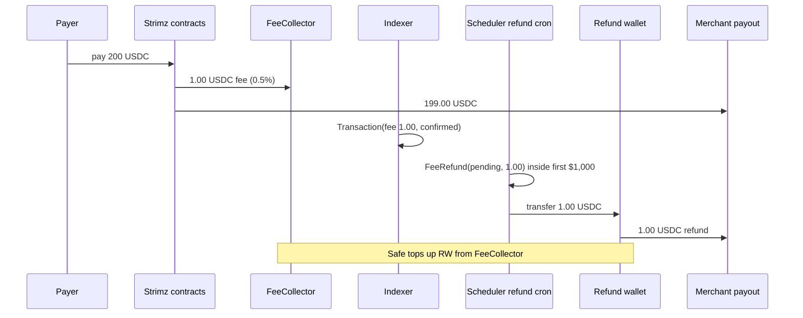

# ADR: Charge the Starter fee from the first payment, and refund the free allowance

- **Status:** Accepted 2026-11-21 by the founder (option A, the refund model).
- **Date:** 2026-11-21
- **Issue:** #512
- **Scope:**
  - API: merchant registration fee.
  - Scheduler: a new refund cron and a refund signer.
  - Prisma: one new table and its migration.
  - Plan-upgrade volume, pooled per business.
  - Docs and dashboard copy.
  - No contract change. The Registry, Payments, Subscriptions and FeeCollector stay as they are.

## Context

- **The free plan today:** 0% until $1,000 of volume, then Starter at 0.5%. Two loopholes (#512):
  - **A 0% window.** The increase from the scheduler key waits 24 hours on chain, so anything paid in that window is free.
  - **New accounts restart the allowance.** A second account for the same business gets another free $1,000.
- **A safe switch is hard.** Switching the fee at the moment the allowance runs out always leaves a race:
  - many checkouts each under the allowance;
  - direct contract payments that only the cron sees;
  - and counting unpaid checkouts would let anyone grief a merchant.
- **The founder's rule:** if it can be broken, it isn't secure yet.

## Decision

### 1. Every merchant pays the Starter fee on chain from the first payment

- **Registration:** `registerMerchantCallData` registers a Free merchant at the Starter fee (`planFeeBps('starter')`, 50 bps) instead of 0. The ceiling stays `MERCHANT_FEE_CEILING_BPS` (500).
- **Plans are unchanged in `PLANS`:**
  - Free is still the plan with no paid features and an effective 0% on the first $1,000;
  - Starter and Growth are unchanged.
- **The plan-upgrade cron is unchanged in behaviour.**
  - Free to Starter now moves the feature plan only, because the fee is already 50, and `applyFee` sees the fee is live.
  - Starter to Growth lowers the fee at once, as today.
- **The contract can always collect the fee.** There's no threshold to race, nothing to time, and no direct-call bypass.

### 2. Strimz refunds the fees on each business's first $1,000

- **One allowance per business.** Accounts that share a payout address or an owner wallet (`linkedMerchantIds`) share one allowance: $1,000 per currency, matching today's per-currency plan thresholds.
- **What earns a refund:**
  - confirmed, non-refund `Transaction` rows in this deployment's mode;
  - in order of `executedAt` across the business;
  - until the business has $1,000 of volume in that currency.
- **The refund amount** is the `feeAmount` actually collected on those payments. A payment that straddles the $1,000 line gets a pro-rata refund of its fee for the part under the line.
- **New table, `FeeRefund`:**

  | Column                   | Meaning                                       |
  | ------------------------ | --------------------------------------------- |
  | `id`                     |                                               |
  | `merchantId`             |                                               |
  | `transactionId`          | unique, so a payment is refunded at most once |
  | `currency`               |                                               |
  | `amount`                 |                                               |
  | `status`                 | `pending`, `sent`, `confirmed` or `failed`    |
  | `txHash`                 |                                               |
  | `nonce`                  |                                               |
  | `createdAt`, `updatedAt` |                                               |

- **Refund cron** (scheduler, every 15 minutes):
  1. It finds eligible payments with no `FeeRefund`, and inserts `pending` rows in one transaction. The unique `transactionId` blocks a double refund.
  2. It pays each merchant's pending total in one ERC-20 transfer to their current payout address, from the refund wallet.
  3. Crash safety: it records the signed transaction's hash and nonce before broadcasting. On restart, it reads the receipt for any `sent` row before doing anything else, so it never signs a second payment for the same rows.
- **Refund wallet:** a dedicated hot key, `REFUND_SIGNER`, used only for refunds.
  - It holds no contract roles.
  - The Safe tops it up from `FeeCollector` (`withdraw`, `TREASURY_ROLE`), with a small float, for example 200 USDC and 200 EURC.
  - The existing gas-balance monitor watches it, and ops are alerted below 20 of each token.
  - When the float can't cover a refund, the cron leaves the rows `pending` and alerts ops. Nothing is lost.
- **Merchants see it:**
  - the dashboard shows "Fees refunded" per payment, with the refund transaction link;
  - the payment receipt email says "0.5% fee, refunded" for payments inside the allowance.

### 3. Docs and copy

- **Docs and dashboard:** "Your first $1,000 in each currency is fee-free: the 0.5% fee is taken on chain and refunded to your payout wallet within about 15 minutes."
- **The website pricing page** isn't changed here. The founder decides its wording.

### 4. What is dropped from the first version of this ADR

- The Registry `instantRaiseCap` change, and the API's upgrade-before-crossing check. Neither is needed when the fee never rises from 0.

## Abuse analysis

- **Sybil accounts.** A refund can only return fees the business actually paid. A fake account that does $1,000 of volume pays $5 and gets $5 back, so it gains nothing.
- **Bursts and direct contract payments.** The contract always charges 0.5%. There's no window.
- **Forged volume.** Refunds come only from `Transaction` rows the indexer projected from confirmed on-chain events. The API can't create them.
- **Griefing.** Nobody can use up another merchant's allowance without paying that merchant: pooling needs a shared payout address, so the attacker's volume lands in the victim's wallet.
- **Double refund.**
  - The unique `transactionId` stops a payment being refunded twice;
  - a single runner with a lock stops two crons racing;
  - the receipt check before any new signing stops a restart paying twice.
- **A leaked refund key** loses at most the float. It has no roles.
- **Refund to an attacker's address.** Refunds go to the current payout address, which only changes after the existing 24-hour on-chain delay. A compromised dashboard can't redirect a refund faster than it could redirect payments.
- **Refund-then-refund.** If a merchant refunds a customer, that payment drops out of the volume. Strimz keeps the fee on the customer refund and doesn't refund it again.

## Diagram

## Consequences

- **The fee can't be avoided on chain.** It's always taken, whatever an attacker does.
- **New merchants see 0.5% taken first,** and get it back within about 15 minutes. The copy says so up front.
- **Ops has to keep the refund float topped up.** Alerts cover that.
- **One more hot key, with a small float.**

## Alternatives considered

- **Switch the fee at $1,000** (the first version of this ADR). Every design leaves a race or a griefing path.
- **Count volume on chain.** It costs gas on every payment, needs a contract change, and needs a USD price for EURC.

## Verification

- **API unit test, red first:** a Free merchant registers at 50 bps.
- **Scheduler e2e:**
  - refunds stop at the pooled $1,000;
  - a payment that straddles the line is refunded pro rata;
  - linked accounts share one allowance;
  - running the cron twice never refunds twice;
  - a crash after signing doesn't sign again;
  - a refunded customer payment is excluded;
  - a short float leaves rows `pending` and alerts ops.
- **Full stack:** a Free merchant takes a 2 USDC payment, the fee lands in `FeeCollector`, and the refund reaches the payout wallet.
- `./scripts/preflight.sh` passes in full.

## Implementation notes (2026-11-21)

These came out of building this and trying to break it.

- **The payout address can't be changed off chain after registration.**
  - `PATCH /v1/merchants/me` and the onboarding form used to write `payoutAddress` for any merchant. A registered merchant's database payout could then differ from the Registry's, which would have let:
    - a hijacked session send refunds to a new address at once;
    - an attacker link their account to a victim's for free.
  - Both routes now answer `409 payout_change_onchain` for a registered merchant. Only the 24-hour on-chain rotation changes it, and the indexer mirrors that change.
  - The dashboard already sent payout changes through the on-chain panel.
- **Only registered accounts link businesses,** in both the refund job and the plan-upgrade pooling. An unregistered account, whose payout address costs nothing to set, can no longer join two businesses together. There's a test for this.
- **Businesses are linked directly or through each other** (union-find) in the refund job, so overlapping links can't double the allowance.
- **The fee the Registry charges is now `onchainFeeBps(tier)`** in `@strimz/shared-config`: Free returns the Starter fee. Registration, checkout fee quotes, the fee-drift monitor and the tier audit script all use it. Plan display still uses `planFeeBps`.
- **The refund wallet:**
  - it's configured with `REFUND_SIGNER_PROVIDER` / `REFUND_PRIVATE_KEY` / `REFUND_KMS_KEY_ID` / `REFUND_SIGNER_ADDRESS`, required in production, KMS-only on mainnet, and refused if it's the scheduler or relayer key;
  - the gas-balance monitor watches it;
  - a failed broadcast alerts ops, at most once a day.
- **Receipt emails are unchanged.** A refund is decided up to 15 minutes after the payment, so the email can't know about it. The dashboard and the new docs page explain it instead.
- **A refund trigger for local and CI runs:** `POST /admin/run/fee-refunds`, refused in production like the other admin triggers.
