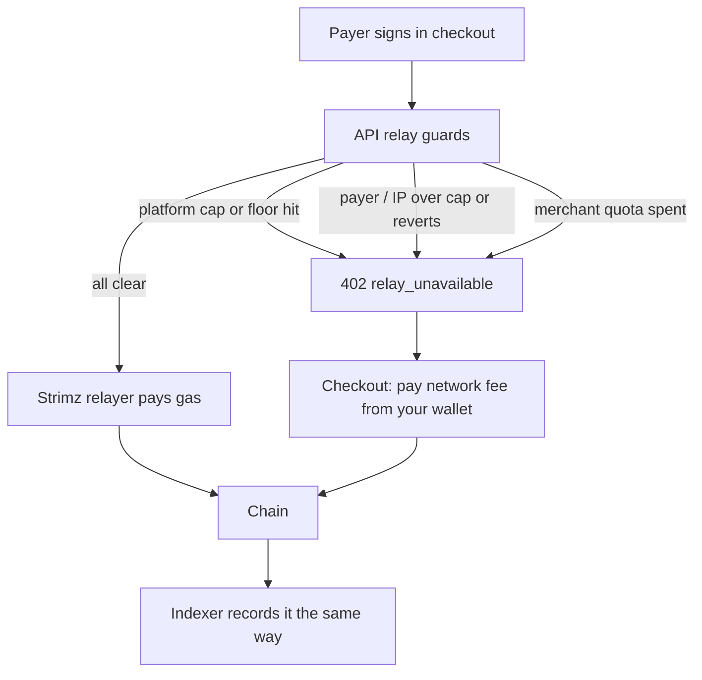

# ADR: Protect the relayer's gas without blocking honest merchants

- **Status:** Accepted 2026-11-21 by the founder
- **Date:** 2026-11-21
- **Issue:** #510
- **Scope:**
  - API relay: budget, guards, and a new answer that says "pay the fee yourself".
  - Hosted checkout and the `/manage` page: a fallback where the payer sends the transaction from their own wallet.
  - Redis counters, config, the ops alerts, and the docs.
  - No contract change, no Prisma migration, and no webhook change.

## Context

Strimz pays gas for every relayed transaction: payments, subscription signups, allowance renewals, subscriber cancels, and merchant registration. On Arc, gas is paid in USDC from the relayer wallet.

**What protects that wallet today:**

- every call is simulated first (`estimateGas`), so a call that reverts is refused before anything is spent;
- no relayed call may use more than 600k gas;
- each merchant has a daily quota (free 500, starter 5,000, growth and enterprise 50,000);
- each IP gets 20 hosted relay calls a minute, and each merchant 60;
- a payment must be at least 1.00 and really paid, and a signup needs a payer holding the plan amount;
- one live attempt per checkout or subscription, and at most 3 relayed cancels per subscription a day;
- an email when the relayer or scheduler wallet falls below 5 USDC.

**The gaps (#510):**

1. **No platform-wide ceiling,** and the low-balance alert doesn't stop anything.
2. **Bulk free merchants.** Each scripted signup brings 500 relays a day, plus an on-chain registration that Strimz pays for.
3. **Quota griefing.** An attacker moves one plan amount from wallet to wallet and enrols each one into a real merchant's plan. That spends the merchant's quota, and the merchant's checkout stops working until 00:00 UTC.
4. **Deliberate reverts.** A smart-contract payer can pass the simulation and revert on chain. Each revert costs up to 600k gas.

**One fact makes a gentler design possible.** `payWithAuthorization`, `permitAndCreateSubscription` and `cancelWithSig` are open to any caller. The payer's signatures bind every field, so the payer's own wallet can send the same call and pay the fee in USDC. The page always shows a live estimate from the network it runs on (gas estimate times the current gas price, in USDC), so mainnet needs no hard-coded figure. Each call's real cost (gas used times effective gas price, from receipts) is measured on Arc testnet before release, and again on Arc mainnet as a launch-checklist item, before the platform cap and floor defaults are confirmed. The payer already holds USDC.

## Principle

The relay is a free extra on top of a checkout that always works. When Strimz declines to pay gas, the checkout doesn't fail: it asks the payer to pay the network fee themselves. Abuse costs the abuser money. It never stops an honest merchant from getting paid.

## Decision

### 1. Self-pay fallback

- **New refusal from the relay:** `402 relay_unavailable`, with `details.reason` set to one of `platform_paused`, `merchant_quota`, `payer_limited` or `ip_limited`. It is never a 429 that strands the buyer.
- **Checkout and `/manage` handle it.**
  - The page shows one line: "Strimz can't cover the network fee for this one. You can pay it from your wallet." The fee shown is the live gas estimate in USDC.
  - A button sends the same signed call from the payer's wallet, using the signatures they already gave, so there's no second signing step.
  - The page then waits for the transaction exactly as it does today, and the indexer records it the same way.
- **Smart wallets** that can't send their own transaction see a plain error asking them to try again later.

### 2. Platform ceiling and floor (gap 1)

- **A daily platform cap** on relayed submissions (`RELAY_PLATFORM_DAILY_CAP`), counted in Redis by UTC day across all merchants. The default is generous: 50,000.
  - Ops are emailed at 50%, 80% and 100%.
  - At 100%, new submissions get `relay_unavailable` (`platform_paused`), and checkout falls back to self-pay.
- **A balance floor** (`RELAYER_MIN_BALANCE_USDC`, default 2 USDC, below the 5 USDC alert).
  - The API reads the relayer balance at most once a minute, and caches it.
  - Below the floor, relaying stops the same way, so the wallet can't be drained to zero, and ops are alerted.
  - Relaying resumes on its own once the wallet is topped up.

### 3. New free merchants start lower (gap 2)

- **A free merchant gets 50 relays a day** until their first settled payment or first successful subscription charge of at least 1.00 that the indexer records. Then they get the plan's full quota automatically.
- **Admins can lift a merchant early** from the admin merchant page. That's an audit-logged action.
- **Merchant registration counts against a platform daily cap** (`REGISTRATION_DAILY_CAP`, default 200). Beyond it, registration waits until the next day; it isn't lost.
- **Privy's invisible CAPTCHA goes on for sign-in.** It's a dashboard setting with no code change, because the dashboard uses Privy's own login modal.

Honest merchants aren't blocked by any of this: their buyers can always self-pay, and the first real payment unlocks the full quota.

### 4. Griefing caps per payer and per IP (gap 3)

These count against the payer, not the merchant.

- **Per payer wallet:** at most 3 relayed signups a day across all merchants, and at most 1 a day for the same merchant.
- **Per IP:** at most 10 relayed signups a day for the same merchant, on top of today's per-minute limit.
- **What happens over a cap:** the request gets `relay_unavailable` (`payer_limited` or `ip_limited`) and falls back to self-pay. It does not use up the merchant's quota.
- **Unpaid signups don't spend the merchant's quota for long.** A signup whose first charge fails, or which is cancelled before any charge, refunds its unit of quota that day. Quota then reflects real customers.

### 5. Deliberate reverts (gap 4)

- **The relay worker records every on-chain revert** against the payer address and the IP that submitted it, with a 24-hour window.
- **After 2 reverts in a day,** that payer and that IP get `relay_unavailable` (`payer_limited`) for 24 hours, and fall back to self-pay, where they pay for their own reverts.
- **A revert never counts against the merchant.**

## Diagram

## Consequences

- **Merchants never lose a sale to a relay limit.** In the worst case their buyer pays the gas for their own transaction.
- **An attacker's spend is bounded per wallet, per IP and per platform-day,** and repeat attempts cost the attacker gas instead.
- **Checkout gets a second submit path.** It's more code to test, but it uses the same signatures and the same indexer path.
- **Some buyers will see a fee prompt** during an attack or once the platform cap is hit. The copy keeps it short and honest.
- **Smart-wallet buyers without gas** can't self-pay. They're rare on Arc, where gas is USDC.

## Alternatives considered

- **Hard 429 when limits are hit.** Rejected: it lets an attacker shut a merchant's checkout.
- **A deposit or stake from new merchants.** Rejected: it raises the entry cost for every honest merchant.
- **Only Privy CAPTCHA.** It's necessary but not enough: it doesn't touch payer-side griefing or reverts.

## Verification

- **Red first:**
  - an API e2e test where 500 enrolments from rotating wallets used to exhaust a free merchant's quota and block checkout; now they are capped per payer and IP and the merchant's quota is untouched;
  - a relay test where a payer with 2 reverts is refused for 24 hours;
  - a platform-cap test, and a balance-floor test with the chain stub returning a low balance.
- **Checkout unit tests** for the self-pay fallback states, plus a full-stack e2e test where the relay answers `relay_unavailable` and the payer's own transaction lands and is recorded.
- **Ops:** the alert emails at 50%, 80% and 100% of the platform cap and at the floor.
- **Costs:** record measured gas used and USDC cost per relayed call type, on testnet now and on mainnet at launch, in `docs/runbooks/relayer-gas.md`.
- `./scripts/preflight.sh` passes in full.

## Implementation notes (2026-11-21)

- **`RelayGuardService`** (API) runs on every relayed call after the attempt claim and before the merchant quota:
  - checks revert counts, then signup caps, then the balance floor, then the platform cap;
  - keeps its counters in Redis by UTC day;
  - caches the relayer balance in Redis for 60 seconds, so every API instance shares it.
- **Merchant quota refusal** is now `402 relay_unavailable` (`merchant_quota`) carrying the call, instead of `429 relay_budget_exhausted`.
- **IP caps apply only to the public checkout routes.** A merchant's own server, calling `/v1/relay` with its key, is never capped per IP. The IP is hashed (`clientKey`) before it reaches Redis or a job.
- **The worker counts reverts** against the job's `payer` and `clientKey`, and gives the merchant its unit back (`RelayBudgetService.release`). Cancels never took a unit.
- **Starter quota:**
  - `Merchant.relayUnlockedAt` is set on the first confirmed payment of at least 1.00 (refunds excluded), found when the quota is next checked;
  - or by `POST /v1/admin/merchants/:id/relay-unlock`, which is audit-logged.
- **Registration cap:** `RegistrationCapService` books each merchant into the first UTC day with room and delays its BullMQ job until then. A merchant keeps its booking.
- **Checkout checks the call before sending it.** The contract, chain and function selector must match the page, using ABIs generated by `scripts/generate-abis.sh` into `apps/checkout/src/lib/generated/relay-calls.ts`.
- **Not built:** refunding a signup's unit when a trial is cancelled before its first charge. A cancel can happen on-chain without Strimz, and the per-payer and per-IP signup caps already bound that path. Revisit in the security review if it matters.
- **Costs** measured on testnet are in `docs/runbooks/relayer-gas.md`. Mainnet is a launch-checklist item.
