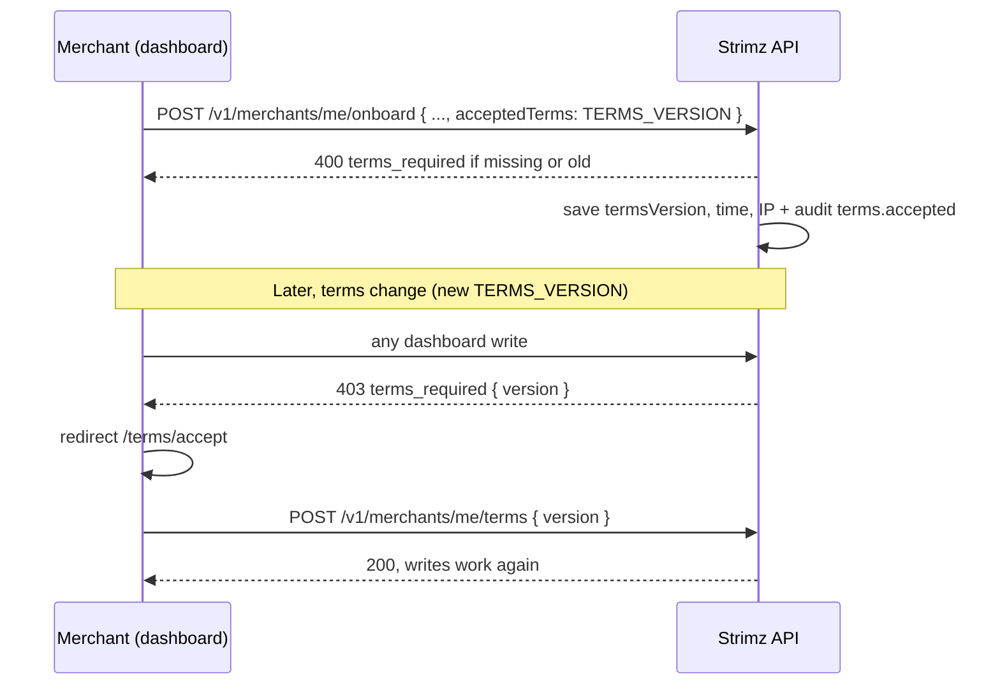

# ADR-2026-11-21: Terms of service in plain English, with recorded, versioned acceptance

- **Status:** Accepted 2026-11-22 by the founder
- **Deciders:** the founder
- **Related:** #508

## Context

The founder asked for clear, plain-English terms that leave no room for ambiguity. Every merchant must tick "I agree to the Terms" before they can submit, and the button stays disabled until they do.

What is live today has three problems:

- **The wrong company name.** The terms, the privacy policy and the dashboard footer name "Strimz Labs Ltd." The company on the CAC certificate is **STRIMZ LTD**, RC 8624034, a private company limited by shares, incorporated on 22 July 2025 under the Companies and Allied Matters Act 2020.
- **The wrong law.** The terms are governed by the laws of England and Wales, with disputes in the courts of London. The founder chose Nigerian law.
- **No record of who agreed to what.** Signup shows "By continuing you agree to our Terms". Nothing records whether a merchant agreed, or to which version.

## Decision

### 1. The documents

- **Terms of Service, rewritten** in plain English: short sentences, one rule per paragraph, defined words used the same way every time, no "including but not limited to".
- **What the terms say:**
  - who the parties are: STRIMZ LTD, RC 8624034, at its registered office;
  - what Strimz does and doesn't do: Strimz is non-custodial, payments settle on-chain to the merchant's payout wallet, and Strimz never holds keys;
  - fees and the free 1,000: the same model as the "Fees and your free $1,000" docs page;
  - network fees: Strimz may pay them or ask the payer to;
  - acceptable use: it links to the policy and lists the outcomes of breaking it;
  - refunds and chargebacks: payments on-chain are final, and refunds are the merchant's own transfers;
  - data: it links to the privacy policy;
  - suspension and closing an account;
  - liability: a cap, with what is and isn't excluded;
  - changes: 14 days' notice by email, plus fresh acceptance in the dashboard;
  - notices: where legal notices go;
  - governing law: Nigeria, with disputes in the courts of the state the founder chooses.
- **Same entity everywhere.** The privacy policy and the dashboard footer get the same name fix. The privacy policy's legal content is otherwise unchanged.
- **Every version has a date.** The terms page shows "Version 2026-11-21". A shared constant, `TERMS_VERSION`, in `@strimz/shared-config`, is the one source for both the page and the API.

### 2. Recording acceptance

- **New columns** on `Merchant`: `termsVersion`, `termsAcceptedAt` and `termsAcceptedIp` (the IP is stored, because legal proof is its purpose).
- **An audit log entry** on each acceptance: `terms.accepted`, with the version.
- **Onboarding:**
  - a required checkbox, "I agree to the Terms of Service and Privacy Policy", with links that open in a new tab;
  - the "Finish" button stays disabled until it's ticked;
  - the onboarding request carries `acceptedTerms: TERMS_VERSION`, and the API refuses onboarding without the current version.
- **Signup screens** keep a one-line notice pointing to the terms. The binding agreement is the onboarding checkbox, because that's where a merchant account starts doing business.

### 3. Enforcement (the API, not only the page)

- **Dashboard sessions with a missing or old version can't make changes.** On merchant write routes they get `403 terms_required`, with `details.version` set to the current version. This covers:
  - creating API keys;
  - plans, sessions, invoices and storefronts;
  - settings;
  - live mode.
    Reads still work, so a merchant can see their data.
- **The dashboard redirects** any merchant whose `termsVersion` isn't current to `/terms/accept`. That page shows what changed and the same checkbox, and calls `POST /v1/merchants/me/terms` with `{ version }`. The API accepts only the current version.
- **Requests made with an API key are not blocked.** A merchant's live integration keeps taking payments while the owner hasn't yet re-accepted. Blocking payments would hurt their customers. The 14-day notice period plus the dashboard block is the lever.
- **Existing merchants** accept once, at their next dashboard visit, when this ships.

## Diagram

## Consequences

- **Good:**
  - The legal entity and law are correct.
  - There's proof of who agreed to which version, and when.
  - Future changes to the terms have a clean path to re-acceptance.
- **Cost:**
  - One migration, with three nullable columns.
  - A check on dashboard write routes.
  - A new acceptance page.
  - Every existing merchant sees one acceptance screen.
- **Not legal advice.** The text is drafted for clarity. A Nigerian lawyer should review it before mainnet.

## Founder decisions (2026-11-22)

- **Notices** go to `legal@strimz.finance`. The only public addresses are `support@`, `legal@` and `hello@strimz.finance`; every other address in the project is corrected.
- **Address:** STRIMZ LTD is described as a company registered in Nigeria, RC 8624034. No street address is published.
- **Courts:** the courts of the Federal Capital Territory, Abuja, under Nigerian law.
- **Also corrected:**
  - the invented London address in the privacy policy;
  - "Strimz Labs" everywhere;
  - stray example addresses (`founder@`, `data@`, and `@strimz.io`).
- **The transactional sender** stays `noreply@mail.strimz.finance`. That's a send-only Resend identity on the `mail` subdomain, not a mailbox; replies go to `support@strimz.finance`.
