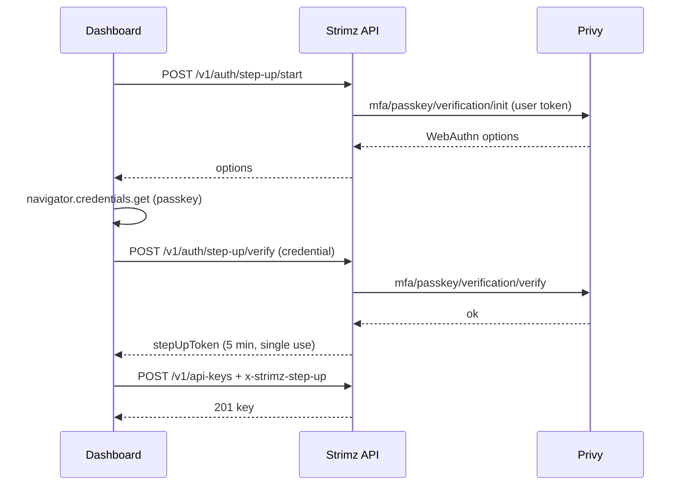

# ADR-2026-11-22: A passkey guards every sensitive action

- **Status:** Accepted 2026-11-22 by the founder
- **Deciders:** the founder
- **Related:**
  - ADR-2026-11-22-live-only;
  - ADR-2026-11-21-custom-auth-screens, which introduced passkeys.

## Context

With live mode only, every API key is a live key. Creating one requires "live-mode eligibility", which includes two-factor authentication (`twoFactorEnabled`, from Privy `mfaMethods`). Strimz has no way to set up two-factor, so no merchant could create a key on mainnet.

The founder decided on 2026-11-22:

- Don't build separate two-factor. Use the passkey.
- The payout wallet starts as the Privy-generated (embedded) wallet. Merchants can change it in the dashboard, but only with their passkey.
- Withdrawals and creating API keys also need the passkey.
- The dashboard asks for the passkey whenever a sensitive action is about to happen.

There are two kinds of sensitive action, and each needs its own enforcement:

1. **Wallet actions:** withdrawals, payout wallet changes and ownership changes. They're transactions signed by the Privy embedded wallet in the browser. Strimz's server never sees them before they're signed, so only Privy can stop them.
2. **Server actions:** creating or rotating an API key, and adding or changing a webhook endpoint. Strimz's API performs these, so the API must check the passkey itself. A check that only exists in the dashboard can be skipped by calling the API directly.

## Decision

### 1. A passkey becomes the merchant's second factor

- **On "Add a passkey"** (onboarding, the weekly offer and Settings), the dashboard links the passkey for sign-in and also enrols it as Privy MFA (`useMfaEnrollment`: `initEnrollmentWithPasskey`, then `submitEnrollmentWithPasskey`). One tap from the merchant does both.
- **`mfaMethods` then includes `passkey`,** so the existing eligibility check (`twoFactorEnabled`) passes. Eligibility reads "email verified, a passkey, onboarding done, payout wallet set".
- **The dashboard and docs** say "Add a passkey" wherever they said "enable two-factor".

### 2. Wallet actions: Privy enforces the passkey

- **In the Privy dashboard** (founder action): turn on MFA with **passkey** as the method, and require MFA for embedded wallet actions.
- **Privy then pauses** every signature by the embedded wallet until the user completes passkey MFA. The dashboard registers `useRegisterMfaListener` and shows a "Confirm with your passkey" dialog, which runs `useMfa` with the passkey.
- **This covers** withdrawals, on-chain payout wallet changes (which also keep their 24-hour delay), ownership handover and refunds signed by the merchant. Privy holds the wallet key, so the dashboard can't be bypassed.

- **Privy only enforces this for users enrolled in passkey MFA.** The founder enabled Transaction MFA on 2026-11-22, with passkey as the only method and a 15-minute cache. So the dashboard opens the withdraw, payout-change and ownership screens only for a merchant whose `mfaMethods` includes `passkey`. A merchant without one is asked to add a passkey first.

### 3. Server actions: the API checks the passkey through Privy

- **New `POST /v1/auth/step-up/start`** (dashboard session only). The API calls Privy `mfa/passkey/verification/init` with the user's token and returns the WebAuthn options.
- **The browser signs** with `navigator.credentials.get`.
- **New `POST /v1/auth/step-up/verify`** sends the credential on. The API calls Privy `mfa/passkey/verification/verify`. On success it stores a **step-up grant** in Redis:
  - bound to the merchant;
  - single-use;
  - valid for 5 minutes;
  - returned as an opaque `stepUpToken`.
- **Sensitive routes require a step-up token** in the `x-strimz-step-up` header, consumed on use. These are:
  - `POST /v1/api-keys`;
  - `POST /v1/api-keys/:id/rotate`;
  - `POST /v1/webhook-endpoints`;
  - `PATCH /v1/webhook-endpoints/:id`.

  Without a valid token they answer `403 step_up_required`.

- **What stays exempt:**
  - Revoking a key or deleting a webhook only reduces access.
  - API-key callers are servers and aren't affected. A key with `api_keys_write` can still mint narrower keys, as today; the passkey guards the dashboard path.
- **A merchant without a passkey** who tries a sensitive action is asked to add one first.

### 4. Payout wallet

New merchants keep the embedded wallet as the payout wallet, as today. Changing it remains the on-chain rotation with its 24-hour delay, now also behind the Privy passkey prompt (section 2).

## Diagram

## Consequences

- **Good:**
  - Mainnet works: merchants can create keys.
  - A stolen session can't create keys, change webhooks, withdraw or move the payout wallet without the merchant's device.
  - No separate two-factor system to build or explain.
- **Cost:**
  - Two new API routes and a guard.
  - The dashboard needs a step-up dialog and an MFA listener.
  - Privy dashboard settings change.
  - Merchants must add a passkey before their first key.
- **Risk: a lost device.** Merchants can add more than one passkey. Recovery when every passkey is lost is a support process (sign in by email, identity check, then reset MFA through Privy) and is documented separately.
- **Open:** whether team members, later, also need passkeys.
