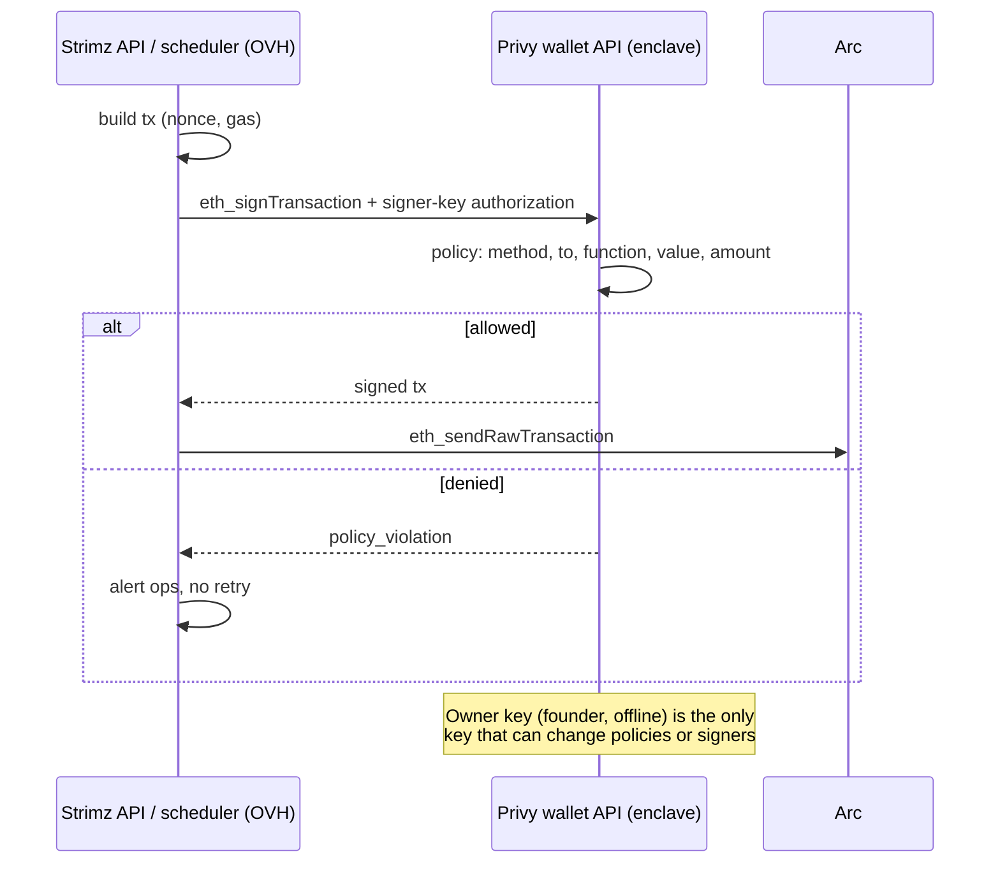

# ADR: Mainnet signing keys held by Privy server wallets, limited by policy

- **Status:** Accepted 2026-11-22 by the founder, amended so that only mainnet uses Privy
- **Date:** 2026-11-22
- **Issue:** #455
- **Supersedes, for mainnet:** ADR-2026-10-11-aws-kms-signers. AWS is gone. ADR-2026-11-13-testnet-software-signer stays in force for testnet until this ships.
- **Scope:**
  - `packages/signer`: a new `privy` provider;
  - signer wiring and env validation in `apps/api` and `apps/scheduler`;
  - a one-off setup script;
  - `infra/lightsail/env.example` and `docs/runbooks/`.

  No contract, schema, queue or webhook change.

## Context

Three hot keys send Strimz transactions:

| Signer        | Service   | Calls                                                                                                                                                                                                                               | On-chain role                                                     |
| ------------- | --------- | ----------------------------------------------------------------------------------------------------------------------------------------------------------------------------------------------------------------------------------- | ----------------------------------------------------------------- |
| Relayer       | API       | `StrimzPayments.payWithAuthorization`; `StrimzSubscriptions.permitAndCreateSubscription` and `cancelWithSig`; USDC `permit` (allowance renewals); `StrimzRegistry.registerMerchant`                                                 | `MERCHANT_REGISTRAR_ROLE`                                         |
| Scheduler     | scheduler | `StrimzSubscriptions.batchCharge` and `cancel`; `StrimzRegistry.commitFeeBps` and `setFeeBps`. Also, only if they are turned on: agent escrow (`createJob`, `approveAndRelease`, `dispute`, `cancelJob`) and CCTP `receiveMessage`. | `CHARGER_ROLE`, `SUBSCRIPTION_CANCELLER_ROLE`, `FEE_MANAGER_ROLE` |
| Refund wallet | scheduler | USDC or EURC `transfer` to a merchant's payout wallet (fee refunds, ADR-2026-11-21-free-plan-fee-integrity)                                                                                                                         | none                                                              |

- **Production refuses plain keys on mainnet.** AWS KMS, the planned mainnet signer, is unavailable: Strimz runs on OVH.
- **There is no budget.** Google Cloud KMS costs roughly $1–2.50 per key a month, and Turnkey gives 25 free signatures a month, then $0.10 each.
- **Plain keys would be a real risk.** The OVH VPS is shared with another project (Solva). A plain key in `.env` could be copied and used from anywhere, at any time, for any call, until the Safe revokes the role and the balance is moved.

**What was checked on 2026-11-22**, against the Strimz Privy app:

- **Privy server wallets sign Arc transactions.** `eth_signTransaction` returned valid EIP-1559 transactions for chain 5042002 and for chain 5042. The signer recovered to the wallet address in both cases.
- **A policy rule limits signing.** A rule allowing `eth_signTransaction` only with `to = StrimzPayments` signed that call. It refused a call to another address, and `personal_sign`, with `policy_violation`.
- **Price:** Privy's free plan includes 50,000 signatures a month across the whole app, then $0.01 per signature. The test wallet and policy (`strimz-test-payments-only`) are left in the app, unfunded.

## Decision

### 1. Keys live in Privy, not on the server

Each mainnet signer is a Privy server wallet: one wallet per signer. Privy holds the private key in its secure enclave, and it never reaches Strimz.

Testnet is Strimz's internal development network and keeps its plain keys (ADR-2026-11-13-testnet-software-signer). The founder decided there are no Privy wallets for testnet.

### 2. Two Privy authorization keys: an owner the server never has, and a signer it does

- **Owner key:**
  - the founder creates it in the Privy dashboard and keeps the private key in the team password manager;
  - it is never on the server;
  - it owns every Strimz signer wallet and every policy;
  - Privy requires its signature to change a wallet's policies or signers, to export a key, or to delete anything.
- **Server signer key, mainnet only:**
  - it is added to each wallet as an `additional_signer` with `override_policy_ids`;
  - its private key is the only Privy secret on the server (`PRIVY_SIGNER_AUTHORIZATION_KEY`);
  - it can only make signing requests that the policy allows.

A server compromise therefore can't:

- remove the policy;
- export a key;
- sign anything outside the rules.

### 3. One policy per signer, deny by default

Unlisted RPC methods are denied by Privy's engine. The allow rules are on `eth_signTransaction` only. Each needs `value = 0`, a `to` from a fixed list, and calldata decoding to an allowed function.

| Signer        | Allowed `to`                            | Allowed functions                                    | Extra limits                                                                                                 |
| ------------- | --------------------------------------- | ---------------------------------------------------- | ------------------------------------------------------------------------------------------------------------ |
| Relayer       | Payments, Subscriptions, Registry, USDC | the relayer calls in the table above                 | —                                                                                                            |
| Scheduler     | Subscriptions, Registry                 | `batchCharge`, `cancel`, `commitFeeBps`, `setFeeBps` | Agent and CCTP calls are left out until those features launch; adding them is an owner-signed policy change. |
| Refund wallet | USDC, EURC                              | `transfer`                                           | amount ≤ 5 tokens (5,000,000 base units): 0.5% of $1,000 is the most one business is ever refunded.          |

### 4. Code

- **`packages/signer`:**
  - adds `PrivyServerSigner`, a viem `LocalAccount` whose `signTransaction` calls Privy's `eth_signTransaction` with the authorization signature (official `@privy-io/node` SDK);
  - its `signMessage` and `signTypedData` throw, because none of these signers sign them;
  - unlike the digest-based `KmsSigner`, it signs whole transactions. That is what lets Privy's policy see the target and function, whereas a raw digest would bypass the policy.
- **Wiring:**
  - the API's `KMS_PROVIDER`, and the scheduler's `SCHEDULER_SIGNER_PROVIDER` and `REFUND_SIGNER_PROVIDER`, gain `privy`;
  - each takes a wallet id and the expected address. At boot the service fetches the wallet and refuses to start if the address differs.
- **Transactions:** nonce management, gas pricing, broadcasting and receipt handling stay in Strimz, unchanged. Only the signature moves.
- **Mainnet:** `ARC_ENVIRONMENT=mainnet` accepts only `privy`. `software` stays testnet-only, as before.
- **Errors:** a Privy `policy_violation` is logged as a security event and alerts `OPS_ALERT_EMAIL`. It is never retried.

### 5. Setup script, run by the founder

`packages/signer/scripts/setup-privy-signers.mjs` (`pnpm privy:setup`) runs on the founder's machine. Secrets come from the shell environment and are never written. Each step is safe to rerun.

1. **`wallets`, before the contract deploy:**
   - creates the three wallets, owned by the owner key, with no rules and no signer, so nobody can sign yet;
   - prints their IDs and addresses for the deploy and handoff.

   Creating them needs no owner signature.

2. **`policies`, after the deploy:**
   - creates the three rules with the deployed addresses;
   - attaches each rule to its wallet and adds the server signer key with that rule.

   This is the only step that needs the owner key.

3. **`smoke`:**
   - signs each allowed call through the server signer key;
   - checks that calls to other contracts, unlisted functions, attached value and refunds over 5 are refused;
   - broadcasts nothing.

The rule definitions live in `packages/signer/src/privy-policies.ts`. Tests in the API and scheduler compare them with the selectors those services actually send.

### 6. Volume

**The free plan's limit:**

- every relayed call, subscription charge and fee refund is one signature;
- merchants' embedded-wallet actions also count against the shared 50,000 a month.

**The relay cap:**

- `RELAY_PLATFORM_DAILY_CAP` is set to **1,500** on mainnet, which is 45,000 a month at most;
- the scheduler warns at 40,000 signatures in a calendar month;
- past the cap, checkout already lets the payer send their own transaction.

## Diagram

## Trade-offs

- **For:**
  - free at launch volume;
  - the keys never touch the server;
  - an attacker on the server is boxed in by the policy;
  - we already depend on Privy, so this adds no new vendor;
  - the setup was tested against Arc.
- **Against:**
  - **Privy becomes a dependency for sending.** During a Privy outage, relaying pauses and checkout falls back to payer-sent transactions. Subscription charges and refunds wait for their next run.
  - **About 200–500 ms more per signature.**
  - **Cost past the free plan:** $0.01 per signature.
  - **A server-signer key leak still allows in-policy calls,** for example relaying valid customer-signed payments, until the owner removes the signer. Those calls need valid user signatures or hit role-gated functions, so the worst case is spent gas.
- **Rejected:**
  - **Plain keys on the server:** any server compromise could copy them.
  - **Google Cloud KMS:** it costs money and has no policy engine.
  - **Turnkey:** 25 free signatures a month.
  - **A hardware wallet:** it can't sign unattended.
  - **Circle developer-controlled wallets:** Circle lists only Arc testnet, and no policy engine was confirmed.

## Rollout

1. The founder creates the owner key (`zn1vk5biyybe3d5hvsdevaw2`) and the mainnet server signer key (`hpa8jye8ydedlfk77bgcmjc3`) in the Privy dashboard (Wallet infrastructure, Keys and quorums). Key IDs aren't secret.
2. Before the deploy, the founder runs `pnpm privy:setup wallets`. It prints the three mainnet addresses, and the deploy and handoff grant their roles.
3. After the deploy, the founder runs `pnpm privy:setup policies` with the owner key, then `pnpm privy:setup smoke`.
4. The server `.env` switches to `privy` (`docs/runbooks/privy-signers.md`). The relayer and the refund wallet get small balances.
5. Testnet is unchanged.

## Verification

- **Unit tests:** `PrivyServerSigner` sends the right request, rejects an address mismatch, maps `policy_violation`, and never retries a denial.
- **Integration tests:** the API relay and the scheduler charge and refund paths run against a stubbed Privy wallet API. They cover the exact request body, the authorization header and the handling of `policy_violation`.
- **The real rules, against Privy's engine, on 2026-11-22:** all 22 checks passed. They ran on the unfunded test wallet with testnet addresses: every Strimz call signed, and calls to other contracts, unlisted functions, attached value and refunds over 5 were refused. The temporary rules were then deleted.
- **Mainnet smoke test, signing only:** as in rollout step 3.
- **Negative check:** a call outside the policy is refused by Privy.
- **Full `./scripts/preflight.sh`.**
