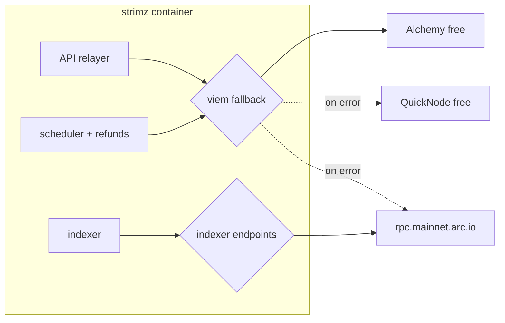

# ADR: One RPC setting for the indexer, a fallback list for the API and scheduler

- **Status:** Accepted 2026-11-22 by the founder
- **Date:** 2026-11-22
- **Scope:**
  - indexer config and boot checks (`apps/indexer/internal/config`, chain client);
  - the API and scheduler chain clients and env schemas;
  - `infra/lightsail/env.example`, docs.

  No contract, schema, queue or webhook change.

## Context

The backend runs in one container, and the API, scheduler and indexer all read `ARC_RPC_URL`. The indexer also reads `ARC_FALLBACK_RPC_URLS`. The API and scheduler have no fallback: one bad RPC stops relaying and charging.

Strimz has no budget for a paid RPC. These are the free endpoints, measured on 2026-11-22:

| Endpoint                    | `eth_getLogs` range                           | Fits                             |
| --------------------------- | --------------------------------------------- | -------------------------------- |
| Public `rpc.mainnet.arc.io` | 2,000 blocks; at most 2,000 results a request | indexer (`BLOCK_BATCH_SIZE` 500) |
| Alchemy free                | 10 blocks                                     | API, scheduler                   |
| QuickNode free              | 5 blocks                                      | API, scheduler                   |

Arc mainnet makes about 2 blocks a second. An indexer on Alchemy or QuickNode would fail every batch. The public RPC is the only free endpoint the indexer can use. The API and scheduler mostly send transactions and read single values, so they suit the keyed endpoints, which are less shared.

## Decision

1. **Indexer:**
   - reads `INDEXER_ARC_RPC_URL` and `INDEXER_FALLBACK_RPC_URLS`;
   - when `INDEXER_ARC_RPC_URL` is unset, it keeps today's settings (`ARC_RPC_URL` and `ARC_FALLBACK_RPC_URLS`), so testnet and local setups don't change.
2. **API and scheduler:**
   - use `ARC_RPC_URL`, then each URL in `ARC_FALLBACK_RPC_URLS` in order, through viem's `fallback` transport;
   - a request moves to the next endpoint only when one fails.

   The refund wallet's client uses the same list.

3. **Boot checks, failing loudly:**
   - every endpoint a service is given must report the configured chain ID, or the service refuses to start. Today only the primary is checked;
   - the indexer also runs one `eth_getLogs` over `BLOCK_BATCH_SIZE` blocks on each of its endpoints. An endpoint that rejects the range stops boot with a message naming the endpoint (its key is redacted). A free keyed endpoint can't then quietly break indexing.
4. **Logs:** URLs that carry a key are never logged in full. Logs show the host only.

**Mainnet settings:**

```
ARC_RPC_URL=<Alchemy mainnet URL>
ARC_FALLBACK_RPC_URLS=<QuickNode mainnet URL>,https://rpc.mainnet.arc.io
INDEXER_ARC_RPC_URL=https://rpc.mainnet.arc.io
INDEXER_FALLBACK_RPC_URLS=
```

The indexer's fallback stays empty until a second endpoint with a wide log range exists.

## Diagram



## Trade-offs

- **For:**
  - the indexer gets the only free endpoint that can index;
  - the API and scheduler survive one provider being down or rate-limited;
  - a misconfigured endpoint is caught at boot, not mid-traffic.
- **Against:**
  - **The indexer still depends on one public endpoint.** If Arc's public RPC is down, indexing pauses and catches up afterwards. A paid endpoint fixes that when there is budget.
  - **Fallback reads can come from different nodes.** The relayer's nonce comes from its own Redis counter, with a re-sync, and the refund reconciler already allows for lagging nodes (#517). So a node a block behind delays a step but doesn't double-send.
- **Rejected:**
  - **Every service on the public RPC:** it is shared and rate-limited, and the senders would have no backup.
  - **The indexer on a keyed free endpoint:** its 5–10 block log ranges can't keep up.

## Verification

- **Indexer unit tests:**
  - which settings it reads;
  - the boot range probe passes and fails as it should;
  - keys are redacted in logs.
- **API and scheduler unit tests:**
  - with a primary and two fallbacks, a request moves on when the primary errors;
  - boot refuses an endpoint on the wrong chain;
  - keyed URLs never appear in logs.
- **Live check of the boot probes:**
  - QuickNode and Alchemy free must be refused for the indexer;
  - `rpc.mainnet.arc.io` must pass.
- **Full `./scripts/preflight.sh`.**
