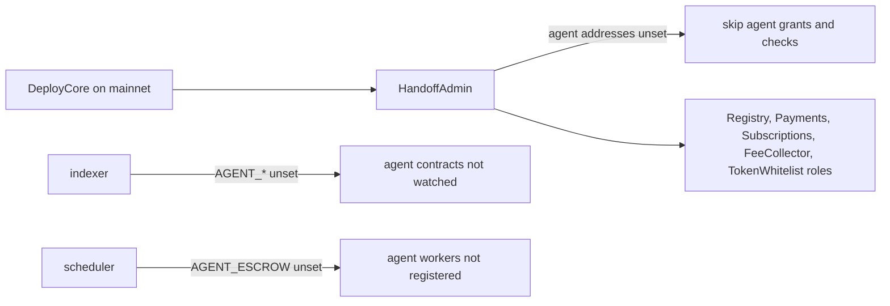

# ADR: Launch mainnet without the agent contracts

- **Status:** Accepted 2026-11-23 by the founder
- **Date:** 2026-11-23
- **Scope:**
  - `packages/contracts/script` (`HandoffAdmin`, `AdminHandoff`, `Verify`);
  - indexer config;
  - the scheduler's env and agent workers;
  - the API agents module;
  - `infra/lightsail/env.example` and the runbooks.

  No change to Solidity in `src/`, to the schema, or to webhook payloads.

## Context

The agent escrow (ERC-8183) has been hidden since #145.

- **#257 lists the work left before it can be used:**
  - nothing funds a job;
  - the scheduler can never release;
  - three lifecycle jobs are never enqueued;
  - approving can create a second on-chain job;
  - several events have no producer.
- **The 2026-11-19 audit** adds M-01, L-01, L-02, L-04, L-05, L-07, L-11 and L-13 on the escrow. #484 records that these must be fixed "before the escrow is unpaused or deployed to mainnet".

Yet every mainnet path requires the agent contracts' addresses:

- `HandoffAdmin` reads `STRIMZ_AGENT_REGISTRY_ADDRESS` and `STRIMZ_AGENT_ESCROW_ADDRESS` with `vm.envAddress`, and `AdminHandoff` reverts on a zero address;
- the indexer requires `AGENT_ESCROW_ADDRESS` and `AGENT_REGISTRY_ADDRESS`;
- the scheduler requires `AGENT_ESCROW_ADDRESS`.

So mainnet can't launch without deploying unfinished, audited-unsafe contracts.

## Decision

1. **The agent contracts aren't deployed on mainnet.** `DeployAgent` isn't run. Testnet keeps its paused escrow.
2. **The handoff treats them as optional.**
   - `HandoffAdmin` reads both with `vm.envOr(…, address(0))`.
   - `AdminHandoff` skips them when both are zero: no grants, no checks, and no pause target.
   - One set and the other zero is refused.
   - `Verify` does the same.
3. **The indexer** treats `AGENT_ESCROW_ADDRESS` and `AGENT_REGISTRY_ADDRESS` as optional, both or neither. An unset contract isn't watched, so it has no cursor.
4. **The scheduler** treats `AGENT_ESCROW_ADDRESS` as optional. Its agent-action worker also cancels subscriptions on chain, so it stays registered. When no escrow is configured, any `job.*` action fails at once with `agent_escrow_not_deployed` as an `UnrecoverableError`, so it is never retried and never reaches the chain. Amended during the build: the first draft said the workers wouldn't be registered.
5. **The API needs no change.** With `commerce` unavailable, `POST /v1/agents/jobs` and `/approve` already answer `403 capability_unavailable`, and nothing is written or queued; `agents-escrow-hidden.e2e` covers this. Amended during the build: the first draft proposed a separate `409`.
6. **Later:** once #257 and the audit findings are done, deploying the escrow is a normal later step:
   1. deploy the agent contracts;
   2. grant their roles from the Safe;
   3. set the addresses;
   4. turn the capability on.

## Diagram

## Trade-offs

- **For:** mainnet carries no unfinished, audited code, and agent support can be added later without a redeploy of the core.
- **Against:** the optional settings must be tested on both sides, set and unset, so a typo can't silently turn indexing of a deployed escrow off. To guard against that, the services refuse one address of the pair without the other.
- **Rejected:** deploying the escrow paused on mainnet. That contradicts #484. A paused contract can still be unpaused by mistake, and it needs a mainnet re-review first.

## Verification

- **Forge tests:** the handoff and `Verify`, with the agent pair unset, with it set, and with only one of them set.
- **Indexer tests:** the optional pair, refusal of a lone address, and a run with no agent contracts.
- **Scheduler tests:** env validation, no workers registered, and a stray job failing permanently.
- **API:** the existing `agents-escrow-hidden.e2e` keeps the refusal covered.
- **A rehearsal on a fork of Arc mainnet:** core deploy, handoff and `Verify`, with no agent contracts.
- **Full preflight.**
