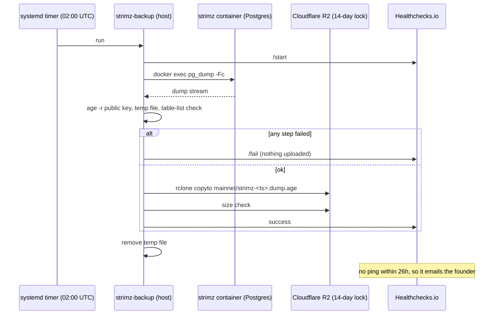

# ADR-2026-11-23: Nightly off-server database backups

- Status: accepted (founder, 2026-11-23)
- Issue: #493

## Context

Strimz's mainnet backend is one container, `strimz`, on one OVH VPS. Postgres 16 and Redis run inside it, and their data lives in one Docker volume. There is no copy anywhere else. The OVH outage on 2026-11-17, and the out-of-memory kill of dockerd on 2026-11-23, showed how much rests on that one disk. The issue was parked until mainnet; mainnet is now live.

What is where:

- **Postgres (database `strimz`)** is the source of truth for everything off-chain:
  - merchants, members and API keys;
  - plans, subscriptions and payment sessions;
  - storefronts;
  - webhook endpoints, events and deliveries;
  - the admin, audit and Safe records;
  - the indexer's cursor.

  It is about 65 MB on disk today.

- **Redis** holds BullMQ queues and caches only. The queues rebuild from Postgres:
  - `webhook-recovery` re-enqueues overdue `pending` and `retrying` deliveries every 30 seconds;
  - `subscription-sweeper` re-locks and re-enqueues due subscriptions every 15 minutes, and reclaims locks older than 10 minutes.
- **On-chain state** (payments, balances, subscriptions in the contracts) is on Arc and needs no backup. The indexer resumes from the cursor stored in Postgres, so a restored database replays chain events from the cursor in the restored dump.
- **The server's `.env.mainnet`** holds secrets. It is out of scope here; the private ops manual covers it.

## Decision

A nightly, encrypted `pg_dump` of the `strimz` database, uploaded to Cloudflare R2 and kept for 14 days. A bucket lock means not even the server can delete a backup early. The founder chose R2, Healthchecks.io, the password manager for the key and 03:00 WAT.

1. **Schedule:** a systemd timer on the OVH host, `strimz-backup.timer`, at 02:00 UTC (03:00 WAT) daily, with `Persistent=true`, so a night missed while the server was down runs at the next boot.
2. **Dump:** `docker exec strimz su-exec postgres pg_dump --format=custom strimz`.
   - It is a consistent snapshot taken without stopping payments or the API.
   - Redis is not backed up (see Context).
3. **Encrypt:** the dump is piped straight into `age -r <public key>` and written to a temp file on the host. The plaintext never touches disk.
   - The founder makes the `age` key pair on their Mac and keeps the private key in their password manager.
   - The server holds only the public key, so a hacked server can't read any backup.
4. **Upload:** `rclone` copies the file to `r2:<bucket>/mainnet/strimz-<UTC timestamp>.dump.age`, then checks that the uploaded size matches.
   - The R2 token is scoped to that one bucket, with object read and write only.
   - The token, the public key and the ping URL live in `/etc/strimz-backup.env`, owned by root, mode 600.
5. **Retention and tamper-proofing, set on the bucket:**
   - a bucket lock rule keeps every object for 14 days; overwrite and delete fail during that time, even with the server's token;
   - a lifecycle rule deletes objects after 15 days.
6. **Alerting:** Healthchecks.io gets `/start`, then success or `/fail`.
   - The check expects one ping a day, with 2 hours' grace.
   - A failed dump, a failed upload, or no ping at all (server down, timer broken) emails the founder.
   - The ping carries no data.
7. **Sanity checks before upload:**
   - `set -o pipefail`, so a failed `pg_dump` fails the run;
   - the dump's table list (`pg_restore --list`, read from the same stream) must hold data for `Merchant` and `_prisma_migrations`. A size floor can't work: the schema alone is about 117 KB of today's 146 KB dump. _(Changed during build, from "larger than 100 KB".)_
   - `age` must exit 0.
     A failed run uploads nothing and pings `/fail`. The temp file is always removed.
8. **Repo files:**
   - `infra/backup/strimz-backup.sh`;
   - `strimz-backup.service` and `strimz-backup.timer`;
   - `infra/backup/env.example`, with names only;
   - `infra/backup/install.sh`, which installs everything and asks for the values through hidden prompts;
   - `infra/backup/verify-restore.sh` and `row-counts.sql`, for the restore check on the founder's Mac.
   - The script is installed to `/usr/local/sbin/strimz-backup`, so a later `git pull` can't change what root runs without a deliberate reinstall.
9. **Host changes on OVH** (stated before each step, Solva untouched):
   - `apt install age rclone`;
   - the script, the env file and the two systemd units;
   - `systemctl enable --now strimz-backup.timer`.
     Nothing touches the `strimz` container, Solva or the swap files.
10. **Restore runbook** (`docs/runbooks/database-restore.md`):
    - download;
    - `age -d` with the private key;
    - `pg_restore` into a throwaway `postgres:16` container to check it;
    - for a real restore: stop the app processes inside `strimz` (`supervisorctl stop`), recreate the database, `pg_restore`, start the processes, and check the indexer catches up.
11. **One test restore** before #493 closes: last night's backup is restored into a throwaway container, and its table row counts are compared with the live database. The result goes in the runbook.
12. **Privacy policy:** the Cloudflare line adds "encrypted database backups", and Retention adds that backups are kept for 14 days.

## Consequences

- **Data loss window:** at most one day of off-chain changes, such as new API keys, settings, webhook endpoints, storefront edits and payment sessions not yet paid.
  - On-chain payments in that window are not lost: the indexer replays them from the restored cursor.
  - Its writes are idempotent upserts, which the real-restore checklist confirms.
- **A lost private key makes every backup unreadable.** That is the price of the server never holding it. The runbook says so first.
- **A hacked server** could stop the backups, which Healthchecks.io would notice. It could upload junk, but it couldn't delete or replace past backups (bucket lock), and it couldn't read them (no private key).
- **Cost:** about 14 × the compressed dump (well under 1 GB) sits inside R2's free 10 GB. Healthchecks.io's free tier covers one check.
- **Recurring human work:** none, besides a restore drill when the schema changes a lot. The runbook suggests one each quarter.
- No API, schema, contract or app change. The container image is unchanged.

## Alternatives considered

- **OVH Object Storage:** rejected; same provider, so one account problem takes out both copies.
- **Backblaze B2:** rejected; a new account to manage, when Cloudflare is already in use.
- **A volume snapshot instead of `pg_dump`:** rejected; copying a live data directory isn't consistent, and stopping Postgres stops payments.
- **Streaming the dump straight to R2:** rejected; a failure mid-stream could leave a truncated object that the bucket lock then keeps for 14 days. A local encrypted temp file is checked first.
- **WAL archiving for point-in-time recovery:** rejected for now; more moving parts than a 65 MB pre-launch database needs. Revisit if the one-day window becomes too wide.
- **Strimz's own email for alerts:** rejected; it stays silent when the whole server is down.

## Tests

- `infra/backup/strimz-backup.sh` gets a shell test with stubbed `docker`, `age`, `rclone` and `curl`:
  - a failing `pg_dump` uploads nothing and pings `/fail`;
  - a dump without `Merchant` data uploads nothing (changed from "an undersized dump");
  - a good run uploads once to `mainnet/strimz-<timestamp>.dump.age` and then pings success;
  - the temp file is gone in every case.
- The script is checked with `bash -n` and `shellcheck`, if it's installed.
- The live test restore is recorded in the runbook.
