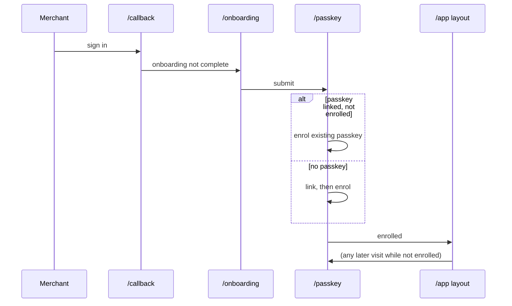

# ADR-2026-11-23: A passkey is a required sign-up step

- Status: proposed
- Issue: #560
- Builds on: ADR-2026-11-22-passkey-step-up

## Context

Sign-up today is two required steps (sign up, onboarding) and one optional one (`/passkey`, with "Skip for now", offered again at most every 7 days by the callback).

On mainnet the founder finished onboarding on a new account, reached `/passkey`, and was sent straight on to `/app` before adding a passkey. The browser already held a Strimz passkey for a different account. Settings on the new account then listed "Passkey from Chrome" as linked, with the warning that it can't confirm sensitive actions: linked, not enrolled. That is the trigger: `/passkey` leaves as soon as Privy lists any linked passkey (`passkeysOf(user.linkedAccounts).length > 0`). It never checks that the passkey is enrolled as this account's second factor (`user.mfaMethods` includes `passkey`). Nothing brings the merchant back afterwards.

Money actions already need a passkey step-up, server-side (ADR-2026-11-22-passkey-step-up). An account without an enrolled passkey can sign in but can't withdraw or change its payout wallet, and finds that out only when it tries.

## Decision

The flow becomes three required steps: **sign up → onboarding → passkey**. "Done" means a passkey that is **enrolled for MFA** (`hasPasskeyMfa(user)`), not just linked.

1. **`/passkey` has no skip.**
   - No passkey linked: **Add a passkey**, which links it and then enrols it (as today).
   - A passkey linked but not enrolled: **Use my passkey for confirmations**, which runs the enrolment with the existing credential IDs.
   - Enrolled: go on to `next`.
   - The browser can't make passkeys: the page says so, suggests a current Chrome, Safari, Edge or Firefox, or a phone through the browser's QR option, and offers **Sign out**. There's no way past it.
2. **The callback always routes an un-enrolled merchant to `/passkey`** after onboarding. The 7-day offer throttle (`shouldOfferPasskey`, `lastPasskeyOffer`, `notePasskeyOffer`) is removed.
3. **The dashboard layout gates `/app/*`.** Once Privy is ready and the merchant is onboarded but not enrolled, it redirects to `/passkey?next=<current path>`. This covers existing merchants, deep links and a passkey removed later.
4. **Settings refuses to remove the last enrolled passkey.** `canRemovePasskey` gains the rule, and the button explains why.
5. `PasskeyGate` on Withdraw and Settings stays as a second line, for a session where Privy's state changes mid-visit.

## Consequences

- Every merchant can confirm withdrawals from day one; no surprise at the first payout.
- Existing merchants without an enrolled passkey (today only the founder's accounts; pre-launch) see `/passkey` on their next dashboard visit.
- **Lost device** (corrected after approval, from Privy's docs): a lost passkey still counts as enrolled, so the gate lets the merchant in; they can't confirm withdrawals or payout changes. This was already true under ADR-2026-11-22-passkey-step-up. Privy resets MFA only through support@privy.io on Enterprise plans, and its unlink API can't remove passkeys. Synced passkeys (iCloud Keychain, Google Password Manager) and a second passkey are the protection. See `docs/runbooks/lost-passkey.md`.
- The gate is client-side. It is UX, not the security control: the API's step-up on money actions stays the enforcement.
- No API, schema, contract or job change.

## Alternatives considered

- **Keep it optional with a stronger nudge.** Rejected: the founder wants it required, and an un-enrolled account fails at the worst moment, its first withdrawal.
- **Enforce it in the API for every route.** Rejected: reads like the dashboard home don't move money, and the money routes already enforce the step-up.

## Tests

- Red first: `/passkey` with a linked but un-enrolled passkey must not redirect. It currently does.
- `/passkey` has no skip; an unsupported browser offers only sign-out.
- The callback sends an un-enrolled, onboarded merchant to `/passkey` with no throttle.
- The dashboard layout redirects an un-enrolled merchant with `next` kept.
- Settings can't remove the last enrolled passkey.
