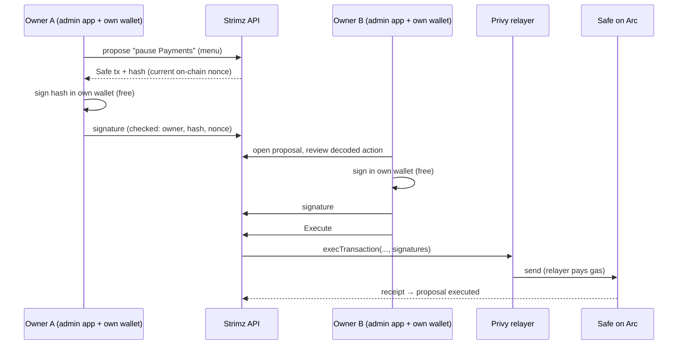

# ADR: A Safe console in the admin app

- **Status:** Proposed (revision of the version approved on 2026-11-23, which never reached `main`)
- **Date:** 2026-11-23
- **Scope:**
  - `apps/admin`: a new Safe page;
  - `apps/api`: Safe proposal endpoints, a Prisma table and a relayed execute;
  - `packages/signer`: one new relayer policy rule;
  - the runbooks.

  No change to the contracts.

## What changed from the approved version

1. **Owners connect through Privy's external wallet connector.** The founder has turned on external wallets in the Privy app, EVM only, with wallet sign-up off.
2. **Owners never pay gas.** Approving is an off-chain signature and costs nothing. When enough owners have signed, the API sends `execTransaction` from the Privy relayer, which pays the network fee. Before, an owner sent it from their own wallet.
3. **The 2-of-3 Safe and the handoff are already live on mainnet.** The Safe-creation part of the old ADR is done, so this ADR covers only the console.
4. **The menu matches the deployed roles** (`script/utils/AdminHandoff.sol`). The handoff gave the Safe `ADMIN_ROLE` directly on Registry, Payments and Subscriptions, as well as through the Timelock. So unpausing and the operational roles are direct Safe actions. Only roles administered by `DEFAULT_ADMIN_ROLE`, which only the Timelock holds, wait 48 hours. Only Payments and Subscriptions are pausable.

## Context

- **What the Safe holds** after the handoff:
  - `ADMIN_ROLE` on Registry, Payments and Subscriptions, directly. That lets it unpause, and grant or revoke the operational roles whose admin is `ADMIN_ROLE`:
    - `MERCHANT_REGISTRAR_ROLE` and `FEE_MANAGER_ROLE` on the Registry;
    - `CHARGER_ROLE` and `SUBSCRIPTION_CANCELLER_ROLE` on Subscriptions;
  - `PAUSER_ROLE` on Payments and Subscriptions;
  - `TREASURY_ROLE` on the FeeCollector;
  - the Timelock's proposer and canceller roles.
- **The Timelock** holds `DEFAULT_ADMIN_ROLE` everywhere, and with it every other role grant. Its executor role is open, so anyone can run a scheduled operation once it is ready.
- **The guardian** (owner A) holds `PAUSER_ROLE` and the Timelock canceller role. It can't unpause or change anything.
- **The Safe web app doesn't support Arc.** There is no other way to sign today except the command line.
- **The contracts check `msg.sender`.** A guardian pause or cancel must come from the guardian's own wallet. The relayer can't send it on the guardian's behalf.

## Decision

### Who can use it

- A `super_admin` signed in to the admin app.
- They also connect their owner wallet (MetaMask, or a hardware wallet through it) with Privy's `useConnectWallet`. This links an external wallet to their existing account; it can't be used to sign up.
- The page reads the Safe's owners from the chain. Only an owner can propose or sign, and only the guardian sees the guardian panel.

### What it shows

- The Safe's owners, threshold and nonce, read live from the chain.
- Proposals, each with its decoded action, its signatures and its status.
- Queued Timelock operations, with when each becomes ready.

### What it proposes: a fixed menu, never raw calldata

| Action                                                                                              | Path                                                              |
| --------------------------------------------------------------------------------------------------- | ----------------------------------------------------------------- |
| Pause or unpause Payments or Subscriptions                                                          | Safe → contract                                                   |
| Withdraw fees from the FeeCollector                                                                 | Safe → FeeCollector                                               |
| Grant or revoke an operational role (registrar, fee manager, charger, subscription canceller)       | Safe → contract                                                   |
| Grant or revoke any other role on Registry, Payments, Subscriptions, FeeCollector or TokenWhitelist | Safe → `Timelock.schedule`; after 48 h, Safe → `Timelock.execute` |
| Add, remove or swap a Safe owner; change the threshold                                              | Safe → itself                                                     |
| Cancel a queued Timelock operation                                                                  | Safe → `Timelock.cancel`                                          |

A Timelock action needs two rounds of approvals: one to schedule it and one to execute it after the delay. The console offers "Execute" on a scheduled operation once it's ready. Contract upgrades stay out of the menu and use the runbook.

### How a proposal is signed and sent

1. An owner picks an action. The API builds the Safe transaction:
   - from the menu only;
   - at the Safe's current on-chain nonce;
   - with `gasPrice`, `gasToken` and `refundReceiver` all zero, so the Safe never pays anyone back.
2. The browser and the API each compute the EIP-712 Safe transaction hash. The browser refuses to sign if they differ.
3. The owner signs the hash in their own wallet (`eth_signTypedData_v4`). That costs nothing.
4. The API stores the signature only if:
   - it recovers to a current owner;
   - it is for that hash and the current nonce;
   - that owner hasn't already signed.
5. Once the signatures meet the threshold, any owner presses **Execute**.
   - The API sends `execTransaction` from the **Privy relayer**, which pays the gas.
   - The API records the transaction hash and marks the proposal executed from the receipt.
   - A proposal whose nonce the Safe has already used is marked stale.

### Relayer policy

The relayer gets one new Privy rule: `execTransaction` on the Safe address, with value 0 and `gasPrice` 0. Privy refuses everything else, as now.

- **What a stolen relayer could do with it:** nothing new. `execTransaction` only runs with valid signatures from two owners.
- **What it costs:** the relayer pays a fraction of a cent per execute, in USDC.

Adding the rule needs the founder's owner key once, through `pnpm privy:setup policies`, as before.

### Guardian panel

- **Pause** Payments, Subscriptions and Registry.
- **Cancel** a queued Timelock operation.

Both are sent from the guardian's own wallet, because the contracts check who sends them. Each costs well under 0.01 USDC. This is the only thing in the console an owner pays for.

### Storage and audit

- **The `SafeProposal` table holds:**
  - the action and its inputs;
  - `to`, `value`, `data`, `operation`, nonce and hash;
  - the signatures, each with its signer;
  - its status (`collecting`, `ready`, `executed`, `stale`, `failed`);
  - who proposed it, and the execute transaction hash.
- **A signature can't move anything alone.** It is valid only for that exact transaction and nonce, and only together with a second owner's.
- **Audit log:** every proposal, signature and execute is written to the admin audit log.

## Diagram

## Trade-offs

- **For:**
  - no third-party Safe UI;
  - owners hold no gas and pay nothing to approve;
  - a fixed menu removes blind signing;
  - 2-of-3 survives one lost key.
- **Against:**
  - more code in a security-critical place;
  - Execute depends on the API and the relayer. As a fallback, any owner can send the same signed transaction from their own wallet, from the console or with `cast`, per the runbook;
  - the guardian still pays a tiny fee to pause.
- **Rejected:**
  - **Owners send Execute:** each owner would need USDC for gas, which the founder doesn't want.
  - **Raw calldata in the menu:** blind signing is how Safes get drained.
  - **A direct unpause:** the contracts require `ADMIN_ROLE`, and that sits behind the Timelock by design.

## Verification

- **API tests:**
  - the Safe hash matches `getTransactionHash` on a fork of Arc mainnet;
  - signatures are refused from a non-owner, for a stale nonce, for a different hash and as duplicates;
  - only `super_admin` reaches the endpoints;
  - each action builds the expected calldata;
  - refund fields are always zero;
  - every step is audit-logged.
- **Signer test:** the new relayer rule allows only `execTransaction` on the Safe.
- **A rehearsal on a fork of Arc mainnet** with the real Safe:
  - pause, then unpause, each with two signatures and executed by the relayer;
  - schedule a role grant through the Timelock, advance 48 hours, then execute it;
  - the guardian pauses alone, then cancels a queued operation;
  - fee withdrawal.
- **Full preflight.**
