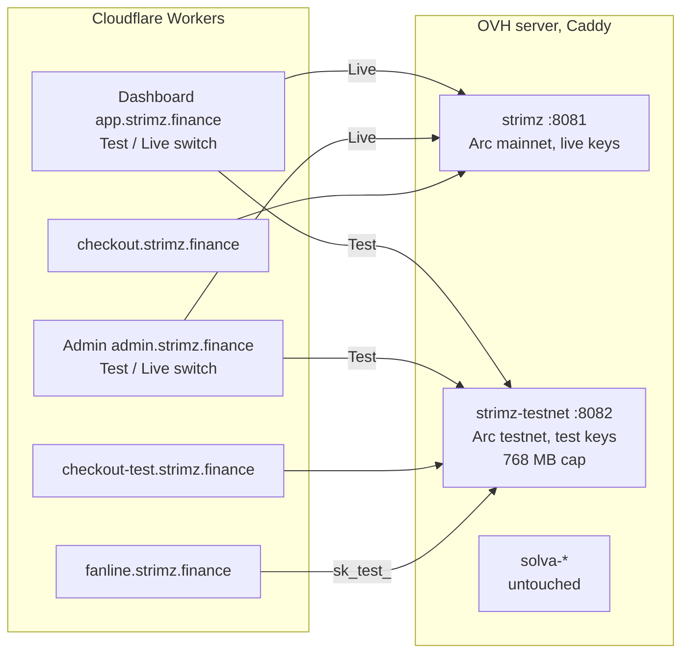

# ADR-2026-11-26: Test mode on Arc testnet, beside live mode

- **Status:** Accepted 2026-11-26 by the founder
- **Date:** 2026-11-26
- **Supersedes:** ADR-2026-11-22-live-only
- **Builds on:** ADR-2026-10-12-one-chain-one-mode (one chain and one mode per deployment), ADR-2026-11-23-required-passkey
- **Scope:**
  - **Server:** a second backend container, `strimz-testnet`, on the OVH server, and its Caddy hostname.
  - **Contracts:** the testnet core is redeployed with `docs/runbooks/testnet-redeploy.md`.
  - **`apps/api`:** no passkey step-up on testnet; test-mode labels on emails.
  - **`apps/dashboard`, `apps/admin`:** one app talks to both backends, with a Test / Live switch.
  - **`apps/checkout`:** a second Worker built for testnet.
  - **`packages/sdk`, `packages/sdk-react`:** the default API host follows the key's mode.
  - **`apps/docs`, `apps/web`:** test mode is documented again.
  - **`apps/demo-merchant` (Fanline):** relaunched on testnet with a 1 USDC cap.
- **Not in scope:**
  - Solidity changes;
  - a mode column or mode switch inside one database, because each backend keeps one chain and one mode;
  - nightly backups for testnet.

## Context

On 2026-11-22 Strimz chose live mode only, because a second deployment looked too expensive on a server shared with Solva. Merchants were told to test with small real payments.

On 2026-11-25 and 2026-11-26 the founder reversed this:

- Businesses building on Strimz need a test mode while they build, and switch to live when they launch.
- People deciding whether to sign up want to try Strimz first.
- Fanline, the demo creator platform, should let anyone and Strimz's content creators try payments without spending real money.

**What already exists:**

- `sk_test_` and `pk_test_` keys, and `mode` columns, are still in the code (`packages/shared-config/src/api-keys.ts`).
- `assertDeploymentMode` (`apps/api/src/common/guards/deployment-mode.ts`) refuses keys of the wrong mode, so a testnet backend only accepts test keys and mainnet only live keys.
- The web apps read the network from `NEXT_PUBLIC_ARC_ENVIRONMENT` at build time. Each build talks to one API (`packages/web-shared/src/lib/env.ts`).
- The SDKs default to `https://api.strimz.finance` (`packages/sdk/src/client.ts`, `browser-client.ts`).
- Passkey step-up guards key creation and rotation, webhook endpoint creation and secret rotation (`@RequireStepUp`), and Withdraw and refunds in the dashboard (`PasskeyGate`).
- Signing up runs `/v1/auth/sync`, then the onboarding form (`POST /v1/merchants/me/onboard`), then the required passkey step. The API registers the merchant on-chain itself (`merchant-chain.service.ts`), paid by the relayer.

**What the server has (measured 2026-11-25):**

|        | Total   | Used           | Free   |
| ------ | ------- | -------------- | ------ |
| Memory | 3.7 GB  | 1.6 GB         | 2.1 GB |
| Disk   | 38 GB   | 26 GB          | 12 GB  |
| CPU    | 2 cores | load about 0.2 |        |

- `strimz` (mainnet) uses about 430 MB, and Solva about 45 MB.
- Solva has no real users, only a frontend sandbox demo, so its load stays low.
- The Strimz image is 2.8 GB and serves either network from its environment, so a testnet container needs no second image.
- The 6 GB of swap is not in `/etc/fstab`, so it's lost on reboot.

## Decision

1. **Two backends on the same server, each with one chain and one mode:**

   |                 | Live                                    | Test                                                                      |
   | --------------- | --------------------------------------- | ------------------------------------------------------------------------- |
   | Container       | `strimz` on `127.0.0.1:8081` (as today) | `strimz-testnet` on `127.0.0.1:8082`                                      |
   | Network         | Arc mainnet                             | Arc testnet                                                               |
   | Keys            | `sk_live_`, `pk_live_`                  | `sk_test_`, `pk_test_`                                                    |
   | Database volume | `strimz-mainnet-data`                   | `strimz-data`, reset                                                      |
   | API host        | `api.strimz.finance`                    | `api-test.strimz.finance`                                                 |
   | Checkout        | `checkout.strimz.finance`               | `checkout-test.strimz.finance`                                            |
   | Signers         | Privy server wallets                    | plain keys, as on testnet before (ADR-2026-11-13-testnet-software-signer) |
   | Backups         | nightly                                 | none; testnet data can be thrown away                                     |
   - The test container runs the same image tag as live, with `--memory=768m` and `--restart=unless-stopped`. That cap keeps a busy testnet from starving mainnet or Solva.
   - Before it starts, swap goes into `/etc/fstab` so it survives a reboot.
   - Every backend release is deployed to both containers. Mainnet goes first, and testnet follows once mainnet is healthy.

2. **One sign-up creates both accounts.**
   - The dashboard runs `/v1/auth/sync` and the onboarding form against **both** APIs, using the same Privy login (one Privy app for both).
   - Each API registers the merchant on its own chain.
   - If one side fails, the dashboard shows the side that worked. On the next load it repeats onboarding on the missing side, using the business details the other side already holds.
   - The required passkey step (ADR-2026-11-23-required-passkey) stays as it is, because the live account is created at the same time.
3. **The dashboard and admin show both, with a Test / Live switch.**
   - Each app is built with the settings of both networks: API URL, RPC, contract addresses and publishable key. The wallet setup lists both chains.
   - The switch sits in the top bar and is remembered per browser. New merchants start in Test.
   - Test mode shows a "Test mode" banner, so test data is never mistaken for live data.
   - Every request goes to the API for the selected mode. That API still enforces its own mode on the server, so the switch only chooses where requests go; it grants nothing.
   - In admin, the switch moves every list, metric and action to the selected backend. The super admin is bootstrapped on both. An admin invite is sent to both backends.
4. **No passkey prompts in test mode.**
   - `StepUpGuard` lets the request through when the backend's chain is testnet.
   - `PasskeyGate` and the refund signer skip the prompt when the dashboard is in Test.
   - Live keeps every step-up.
   - Test keys only work on the testnet backend, and testnet USDC has no value, so skipping step-up on testnet exposes nothing real.
5. **Going live is a key swap.**
   - The SDKs pick their default host from the key prefix: `sk_test_` and `pk_test_` go to `api-test.strimz.finance`, `sk_live_` and `pk_live_` to `api.strimz.finance`. An explicit `baseUrl` still wins.
   - This is released as a minor version of both packages, with a changeset.
6. **Test-mode emails say so.** Subjects start with "[Test]". Each body has a line saying no real money moved.
7. **Docs and the marketing site:**
   - "Testing your integration" becomes "Test mode and live mode", with the Circle faucet steps.
   - Examples show `sk_test_` first, then going live.
   - The changes ADR-2026-11-22-live-only made to the dashboard and docs are reversed where they hid test mode.
8. **Fanline is relaunched on testnet.**
   - It runs as its own test merchant at `fanline.strimz.finance`.
   - Tips are 0.25, 0.50 and 1 USDC, and Pro costs 1 USDC a month.
   - `/api/tip` and `/api/subscribe` accept only those amounts and refuse anything above 1 USDC.
   - Creator handles must be one of the four demo creators.
   - Both routes are rate-limited per IP.
   - The copy says Fanline is a demo, the creators are fictional, and payments use free testnet USDC.
9. **Abuse limits on testnet.**
   - Sign-up keeps Turnstile.
   - The testnet relayer's balance is watched, and topped up from the faucet when it runs low.
   - Registrations per IP are rate-limited, so spam sign-ups can't drain it.
10. **The work ships one issue at a time, in this order:**
    1. this ADR;
    2. the server, testnet contracts, `strimz-testnet` and the test checkout Worker;
    3. the API and SDK changes;
    4. the dashboard;
    5. admin;
    6. the docs and site;
    7. Fanline.

## Diagram

## Consequences

- **Good:**
  - Merchants build against free testnet USDC and switch keys to go live.
  - Visitors and content creators can try Fanline without real money.
  - One login and one onboarding cover both modes.
- **Costs:**
  - About 450 to 768 MB more memory in use on the server.
  - Every backend release is deployed twice.
  - The testnet relayer needs faucet top-ups.
  - Each live sign-up still costs the relayer about 0.003 USDC to register on mainnet.
  - The dashboard and admin carry two network configs.
- **Risks:**
  - If memory runs short, the cap protects mainnet and testnet slows down. The answer then is a bigger OVH plan.
  - Testnet faucet limits or testnet outages pause test mode. Live mode isn't affected.
  - Privy webhooks may only reach one backend. Before the dashboard work, check whether Privy allows a webhook per backend; if not, the live backend forwards the events it gets.

## Alternatives considered

- **Live only, testing with small real payments (ADR-2026-11-22).** Rejected: building and demos need free money.
- **Two separate dashboards, one per network.** Rejected: the founder wants one sign-up for both modes and one place to switch.
- **Simulated test mode on mainnet, with no chain activity.** Rejected: it doesn't exercise the real flow. Checkout, wallets and confirmations would behave differently than in live mode.
- **A second server for testnet.** Rejected for now: it costs money, and the current server has room.

## Verification

- **Server:**
  - `strimz-testnet` is healthy, and `docker stats` shows it under its cap;
  - `strimz` and the Solva containers stay up;
  - `swapon --show` still lists swap after a reboot.
- **API:**
  - a test asserts that a testnet backend skips step-up and a mainnet backend still requires it;
  - a live key on the test API gets `mode_unavailable`, and a test key on the live API gets the same.
- **SDK:** tests show each key prefix picks the right host, and that `baseUrl` overrides it.
- **Dashboard:**
  - a new sign-up appears in both backends;
  - with the switch on Test, creating a key and withdrawing don't prompt for a passkey, and with it on Live they do;
  - the test banner shows only in Test.
- **Admin:** the switch shows each backend's merchants and metrics.
- **Fanline:**
  - a 1 USDC tip completes on testnet;
  - a 1.01 USDC tip and an unknown creator are refused;
  - the rate limit answers 429.
