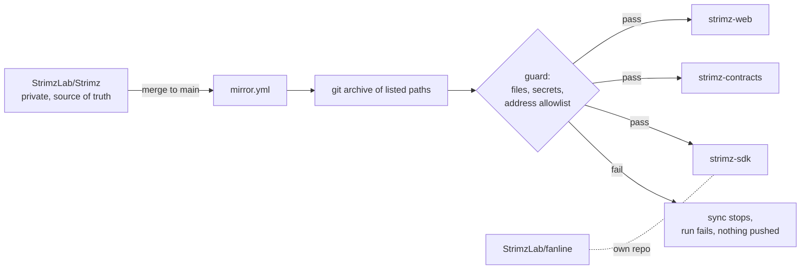

# ADR-2026-11-28: Public read-only mirrors of the SDKs, contracts, site and docs

- **Status:** Accepted 2026-11-28 by the founder, with `strimz-web` read-only (no licence) and CI kept within the free plan's minutes (#590)
- **Date:** 2026-11-28
- **Direction:** the founder chose this on 2026-11-27 and confirmed it on 2026-11-28: keep the private monorepo, publish read-only mirrors. Fanline already has its own public repo (`StrimzLab/fanline`).
- **Scope:**
  - **New:** `.github/workflows/mirror.yml`, `scripts/mirror-sync.sh`, `packages/mirror` (the guard and its tests), `mirrors/` (one folder per mirror: path list, README, licence) and three public repos.
  - **Changed:** `repository` and links in the five published packages (with a changeset), and package READMEs that link to the private repo.
- **Not in scope:** a full repo split, accepting outside PRs on the mirrors, and changes to CI minutes (a separate issue, see Consequences).

## Context

- `StrimzLab/Strimz` holds everything: the API, scheduler, indexer, agent, web apps, contracts and the published packages. It's private again since 2026-11-28, after a period as public.
- Developers want to read the SDKs and contracts, and public contracts build trust. The backend must stay private.
- A full split would turn every shared change (types, chain config, ABIs, key formats) into several PRs and package releases that must land in order. A mismatch there is the kind of bug that charges a payer twice.
- **Shared dependencies:**
  - The SDKs depend on `@strimz/shared-config`, `shared-crypto` and `shared-types`, which are published to npm under MIT.
  - The contracts are MIT (every `.sol` file carries `SPDX-License-Identifier: MIT`). Their mainnet deployment file, `deployments/5042.json`, is gitignored. `broadcast/` (forge run logs) is gitignored.
  - `apps/web` and `apps/docs` import `packages/web-shared`, `packages/ui` and `packages/shared-config`, so a copy of them alone doesn't build.

## Decision

1. **Three public mirrors, each a read-only copy of folders in the private repo:**

   | Repo                         | Folders                                                                                                           | Licence                                           |
   | ---------------------------- | ----------------------------------------------------------------------------------------------------------------- | ------------------------------------------------- |
   | `StrimzLab/strimz-sdk`       | `packages/sdk`, `packages/sdk-react`, `packages/shared-config`, `packages/shared-crypto`, `packages/shared-types` | MIT, as published on npm                          |
   | `StrimzLab/strimz-contracts` | `packages/contracts`, without `lib/` (its `.gitmodules` stays, so `forge install` works)                          | MIT, as in the SPDX headers                       |
   | `StrimzLab/strimz-web`       | `apps/web`, `apps/docs`                                                                                           | all rights reserved: public to read, not to reuse |
   - Each mirror gets a README from `mirrors/<name>/README.md`: what it is, that it's a read-only copy of the code that runs Strimz, how to get help (support@strimz.finance), and links to npm, the docs and Fanline.
   - `strimz-web`'s README says it builds only inside Strimz's own workspace.
   - The contracts package already has a README, so the mirror's note is put in front of it rather than replacing it.

2. **How a mirror is synced:** on every push to `main` that touches a mirror's folders, `.github/workflows/mirror.yml` runs `scripts/mirror-sync.sh all`.
   - **Only tracked files leave.** The script copies the files `git ls-files` lists under the folders in `mirrors/<name>/paths` (a line can also move a folder, for example `packages/contracts .`). Untracked files, `.env` files, build output and gitignored files like `deployments/5042.json` can't be included.
   - **A guard runs on the copy before anything is pushed,** and stops the sync if it finds a problem (see 3).
   - **The push:** the script clones the mirror, replaces its contents with the copy, and commits as "Strimz Bot" with the message `Sync from Strimz (<date>)`. Commit subjects from the private repo stay private. If nothing changed, it pushes nothing.
   - **Fresh history:** the mirrors start empty, so no private commit history is ever published.
   - The workflow also runs by hand (`workflow_dispatch`) to sync all mirrors at once.

3. **The guard (`packages/mirror/src/guard.ts`, run with Node's built-in TypeScript support) fails closed, with tests:**
   - **File names:** refuses `.env*` (except `.env.example`), `*.pem`, `*.key`, `deployments/5042.json`, `broadcast/`, `out/`, `cache/` and `node_modules/`.
   - **Secrets:** refuses real-looking API keys (`sk_live_`, `sk_test_`, `pk_live_` with a full-length body), private keys (`-----BEGIN`, a 64-hex value next to the word `key`), and webhook secrets (`whsec_`).
   - **Addresses:** every `0x` + 40-hex value must appear in `mirrors/address-allowlist.txt`. That list holds public addresses only: testnet contracts, token contracts, the zero address and well-known library addresses. A new address stops the sync until a reviewed PR adds it to the list. So a mainnet contract, treasury or signer address can't leak, even though the guard can't see the private manual.
   - **Vitest tests** feed it each kind of leak and a clean tree.

4. **Access:** each mirror has its own SSH deploy key with write access to that repo only.
   - The private half is stored as a secret in the private repo: `MIRROR_KEY_SDK`, `MIRROR_KEY_CONTRACTS`, `MIRROR_KEY_WEB`.
   - A one-off setup script for the founder creates the three repos, generates each key in a temporary folder, adds the public half as a deploy key and the private half as a secret through `gh`, then deletes the files. No key is shown, and no key is pasted anywhere.
   - A leaked key can write to one public mirror and nothing else.

5. **The mirror repos:** public, issues and wiki off, and a description that says "Read-only mirror".
   - A `PULL_REQUEST_TEMPLATE.md` explains that changes are made in Strimz's own repository and that PRs here aren't merged.
   - GitHub doesn't let a public repo turn pull requests off.

6. **Links:**
   - The five published packages' `repository` field points at `StrimzLab/strimz-sdk`, with the right `directory`.
   - Package READMEs link there, and issue links become support@strimz.finance.
   - A patch changeset releases the new metadata.
   - The main README lists the mirrors.

## Diagram

## Consequences

- **Good:**
  - Developers read the real, current SDK, contract, site and docs code.
  - The backend, ops scripts, runbooks and ADRs stay private.
  - One PR and one preflight still cover every shared change.
- **Costs:**
  - **GitHub Actions minutes:** a private repo on the free plan gets 2,000 minutes a month. Measured over the last 30 days:
    - `ci`: 245 runs × about 11 min ≈ 2,700 min;
    - `docker`: 22 × 26 ≈ 570 min;
    - `Release`: 22 × 2 ≈ 40 min.

    That's about 3,300 minutes, already over the free allowance before mirrors. The mirrors add about 1 to 2 minutes per merge that touches them. Options, in a separate issue:
    - make CI cheaper (for example, run the full matrix only on PRs, and only the changed areas);
    - set a spending limit (extra Linux minutes cost $0.008 each, so about $10 a month at today's rate);
    - move to GitHub Team.

  - Three more repos to keep tidy, though they need no manual work.

- **Risks:**
  - **A secret or private address in a mirrored folder.** The guard and the address allowlist stop it. The risk left is a secret in a format the guard doesn't know; the tests document what it catches.
  - **A broken sync.** It fails loudly in Actions, and the mirror just stays one version behind.
  - **History already exposed.** While `StrimzLab/Strimz` was public, its history could be cloned, including two addresses later removed in #540 (one is the relayer, which is visible on chain anyway). Making the repo private again doesn't undo that, and the mirrors don't add to it.

## Decisions on the open questions (founder, 2026-11-28)

1. **`strimz-web` licence:** none. Its LICENSE says all rights reserved: public to read, not to reuse. `apps/web/package.json` changes from `MIT` to `UNLICENSED` to match.
2. **CI minutes:** no paid minutes or plan. CI must fit the free 2,000 minutes a month (#590, next).

## Alternatives considered

- **A full split into separate repos.** Rejected for now; see Context.
- **Make the whole monorepo public.** Rejected: the backend, runbooks and ops detail must stay private.
- **`git subtree split` to keep history in the mirrors.** Rejected: it would publish private commit messages and old file versions, including ones removed for privacy.
- **A personal access token for pushing.** Rejected: it can usually write to more than one repo. Deploy keys are scoped to one repo each.

## Verification

- `packages/mirror` tests: a planted `.env`, an `sk_live_` key, a private key, a `whsec_` secret and an address that isn't allowlisted each fail the guard; a clean copy passes.
- A dry-run mode of `mirror-sync.sh` builds each copy and runs the guard without pushing. It runs in preflight and in CI's checks job, so a leak is caught before merge, not after.
- After the first real sync: each mirror holds only its listed folders, plus its README and licence. `git log` shows only sync commits. No file matches the guard's rules.
