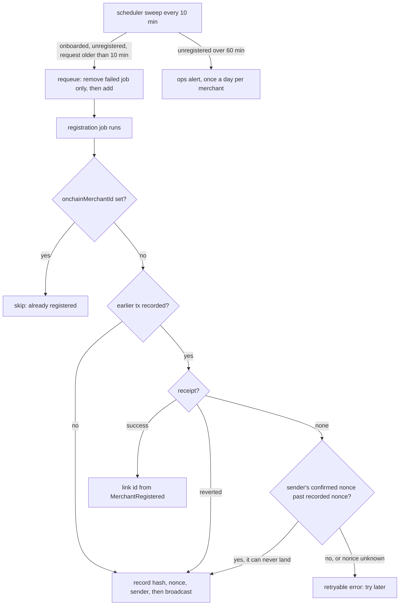

# ADR-2026-11-28: Retry merchant on-chain registration safely

- **Status:** Accepted 2026-11-28 by the founder
- **Date:** 2026-11-28
- **Issue:** #577
- **Scope:**
  - `apps/api`: the registration relay (`relay-job-runner.ts`), `merchant-chain.service.ts` and `queue.service.ts`;
  - `apps/scheduler`: a new `registration-retry` cron;
  - `packages/queue-contracts`: the relay job options (`relaySubmissionJobOptions`), shared by the API and the scheduler;
  - `packages/db`: one migration, two nullable columns on `Merchant`.
- **Not in scope:**
  - Solidity: the registry is unchanged;
  - payment and subscription relays.

## Context

A merchant is registered on-chain by a `registerMerchant` relay job (`merchant-register-<merchantId>`). It's queued at onboarding (`startRegistrationIfEligible`), and again whenever the merchant creates a payment session or invoice (`requestRegistration`).

On 2026-11-27 the first test-mode account's registration reverted (`0xe9eadcb7…7c65`), because the testnet relayer lacked `MERCHANT_REGISTRAR_ROLE`. The role was granted, but the merchant still wasn't registered seven hours later. Three gaps showed up:

1. **A failed job blocks every later request.**
   - The job is marked failed with `removeOnFail: { age: 3600 }`.
   - BullMQ only clears expired failed jobs lazily, when another job in the queue completes or fails. On a quiet queue the failed job stays.
   - Re-adding the same `jobId` is then silently ignored.
   - It took a manual Redis delete to unblock testnet.
2. **Nothing retries on its own.** No sweep looks for onboarded merchants without an `onchainMerchantId`. A merchant who hits a transient failure (RPC outage, gas spike, relayer out of USDC) stays unregistered until they happen to create a payment link.
3. **A blind retry can register a merchant twice.**
   - `StrimzRegistry.registerMerchant` has no duplicate-owner check; every call takes `nextMerchantId`.
   - The runner saves `onchainRegistrationTxHash` before broadcasting. On a fresh job it reuses the earlier transaction only if its receipt says `success`.
   - If the earlier transaction has **no receipt yet** (still pending, or dropped), the runner broadcasts a new one. If the first one then lands, the merchant owns two ids, and the second registration's fee and payout settings have to be undone by hand.

## Decision

1. **The earlier transaction decides.** Before broadcasting, the runner classifies the merchant's last recorded registration transaction:

   | Earlier transaction                                                         | What the runner does                                                                   |
   | --------------------------------------------------------------------------- | -------------------------------------------------------------------------------------- |
   | none recorded                                                               | broadcast                                                                              |
   | receipt `success`                                                           | link the id from `MerchantRegistered` (as today), no broadcast                         |
   | receipt `reverted`                                                          | broadcast again                                                                        |
   | no receipt, and the sender's confirmed nonce is **past** the recorded nonce | the nonce was used by another transaction, so this one can never land: broadcast again |
   | no receipt, and the nonce is **not** past it                                | still pending: don't broadcast; throw a retryable error so the job tries again later   |

   To make the nonce check possible, the runner also records the nonce and sender with the hash before broadcasting:
   - `onchainRegistrationTxNonce Int?`
   - `onchainRegistrationTxFrom String?`

   These are two nullable columns in one migration. Rows from before the migration have no nonce; for them, an earlier transaction with no receipt counts as pending, and retries wait until it has a receipt.

2. **Re-queueing clears a failed job first.** `QueueService` gains `requeueRelaySubmission`:
   - it removes an existing job with the same `jobId` **only** if that job is in the failed state, then adds the new one;
   - waiting, delayed, active and completed jobs are left alone, so a live attempt is never duplicated.

   `merchant-chain.service.ts` uses it for registration.

3. **A sweep retries.** A new scheduler cron, `registration-retry`, runs every 10 minutes and finds merchants that are:
   - onboarded;
   - with a wallet and a payout address;
   - with no `onchainMerchantId`;
   - whose last request (`onchainRegistrationRequestedAt`) is older than 10 minutes, or missing.

   It re-queues up to 25 per run through the same `requeueRelaySubmission` rule. The daily registration cap (`RegistrationCapService`, ADR-2026-11-21-relay-gas-protection) is respected: the sweep reuses the merchant's existing booking (Redis `relay:registration:<id>`) as the job delay, so it never takes a new slot. A merchant with no booking had its booking expire after its slot was used, so it's retried right away without taking another. Rule 1 makes a re-queue safe even if the earlier transaction is still in flight.

4. **Ops hear about stuck merchants.** When the sweep has retried a merchant six times (about an hour), it emails `STRIMZ_ADMIN_ALERT_EMAIL` once a day per merchant. The attempt count lives in `registration-retry:attempts:<id>`, and the once-a-day guard in `alert:registration-stuck:<id>`, both in Redis. The email names the merchant id, the last transaction hash and the reason. Alerts already go out this way for fee refunds.
5. **Both deployments.** Testnet and mainnet run the same code. Testnet's software relayer and mainnet's Privy relayer both report nonces the same way.

## Diagram

## Consequences

- **Good:**
  - A failed registration recovers by itself within about 10 minutes.
  - Ops hear about it if it doesn't.
  - A merchant can't end up with two on-chain ids from a retry.
- **Costs:**
  - one migration;
  - one more cron;
  - one extra RPC read (receipt and nonce) per retry.
- **Risks:**
  - A transaction stuck in the mempool for a long time keeps its merchant waiting. The alert surfaces it. Fixing it means replacing the nonce by hand, the same as any stuck relay.
  - A merchant whose booking is days ahead (the cap was full) waits for that day, not the sweep.

## Alternatives considered

- **Rely on `removeOnFail` age.** Rejected: BullMQ's lazy cleanup means it can block indefinitely.
- **Retry blindly.** Rejected: it can register a merchant twice.
- **A duplicate-owner check in the registry.** Rejected for now: the registry is an upgradeable proxy on mainnet, and changing it needs a Safe and timelock upgrade. One owner may also legitimately run several merchants (sub-merchants). The off-chain rule fixes the actual failure without a contract change.
- **Look the transaction up by hash (`eth_getTransactionByHash`) instead of storing the nonce.** Rejected: a node that never saw the transaction, or already dropped it, returns nothing, which can't be told apart from "dropped and can't land".

## Verification

- **Unit (runner):** a test for each row of the table, with receipts and nonces stubbed. The "no receipt, nonce not past" case must not broadcast.
- **Unit (queue):** `requeueRelaySubmission` removes a failed job and re-adds it, and leaves waiting, delayed, active and completed jobs alone.
- **E2E (scheduler):** the sweep re-queues an onboarded, unregistered merchant past 10 minutes, skips fresh and registered merchants, honours the 25 limit, and alerts once after 60 minutes.
- **Live on testnet:**
  - revoke the relayer's role, onboard a test account, and watch it fail;
  - grant the role back, and the sweep registers it within about 10 minutes, with no manual Redis or payment-link step.
