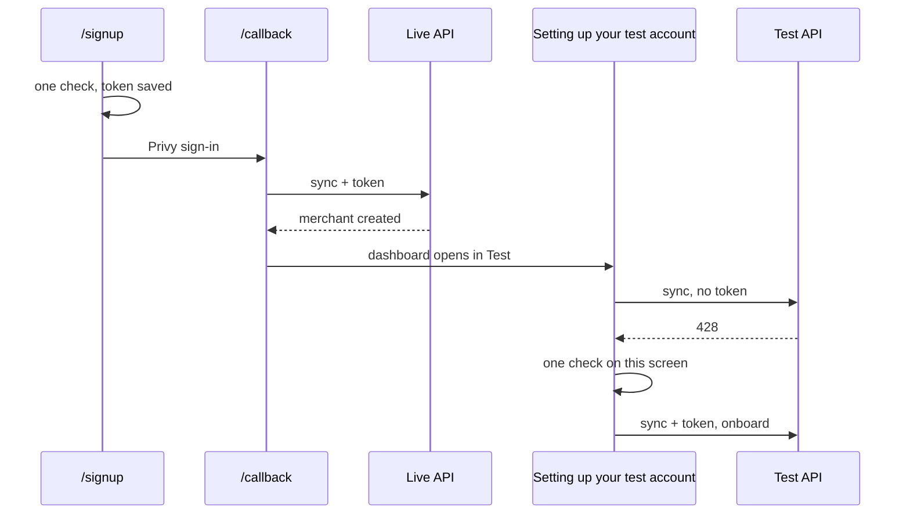

# ADR-2026-11-28: One Turnstile token at sign-up

- **Status:** Accepted 2026-11-28 by the founder: fix the loop, keep the sign-up and login pages and the site's "Sign in" and "Start free" buttons as they are
- **Date:** 2026-11-28
- **Issue:** #588
- **Amends:** ADR-2026-11-26-test-mode (the second Turnstile token at sign-up)
- **Scope:** `apps/dashboard` only: `AuthMethods`, `auth-flow.ts`, `TestAccountReady`. No API, schema or contract change.

## Context

On `app.strimz.finance/signup`, "Verify you are human" spins and returns to an empty checkbox, forever, so nobody can create an account. `/login` works.

- #575 made sign-up fetch a second Turnstile token for the test account: after the first token, `AuthMethods` bumped `resetKey` to render the widget again.
- `TurnstileWidget` calls `onToken(null)` every time it renders.
- `AuthMethods` read that `null` as an expired check. It cleared its "first token saved" flag and marked the visitor as not human.
- The next token was saved as the first one again, which bumped `resetKey` again, without end.

The API asks for a token (action `signup`) only before it creates a merchant. "Setting up your test account" (`TestAccountReady`) already shows its own widget when the test API answers 428 `turnstile_required`.

## Decision

1. Sign-up saves the one token its widget produces, and never renders the widget again by itself. The "Try again" link still does.
2. A `null` from the widget only marks the check as not passed. It no longer touches saved state.
3. The second token slot (`strimz:signup-turnstile:test`) is removed. `TestAccountReady` starts with no token; when the test API wants one, it shows the check on that screen.
4. The sign-up and login pages, and the marketing site's buttons, are unchanged.

## Diagram

## Consequences

- **Good:** sign-up works; the page shows one check, and it stays passed.
- **Cost:** a brand-new user may see a second check on "Setting up your test account". It's on its own screen, with its own explanation, and it can't loop.

## Alternatives considered

- **Keep two tokens, but ignore the `null` from our own reset.** Still two checks back to back on one page, and in browsers that need a click (as in the founder's report), two clicks in a row.
- **Let the test API skip the check for accounts that exist on live.** It would need the test backend to trust the live one; ADR-2026-11-26-test-mode keeps Turnstile on testnet sign-ups to protect the relayer.
- **Merge sign-up and login into one page.** Proposed, then declined by the founder.

## Verification

- Red, then green: `signup-bot-check.test.ts` fails while sign-up's `onToken` resets its widget or saves a second token.
- `auth-flow.test.ts`: one token slot, read once.
- `test-account.test.ts`: a 428 from the test API leads to `needs-check`.
- By hand on a local stack: one check on `/signup` stays passed; a new account is created; the test account asks once, then opens.
